# Training Management Core Service

## C3 — Summary

Component-level view of the Training Management Core Service modular monolith, showing controllers, application and domain services, repositories, integration adapters, background workers, and cross-cutting concerns, plus their interactions with the primary database, reporting store, outbox, identity provider, email, calendar, survey platforms, object storage, and BI tools.

## C3 — Insights

- The service is structured as a modular monolith with clear internal component boundaries per domain (trainer & certification, customer & requirement, scheduling & delivery, feedback & analytics, admin & security), supporting eventual extraction into microservices if needed.
- API controllers are thin, delegating validation and authorization to shared components and orchestration to application services, which in turn rely on domain services for complex business rules (e.g., allocation conflicts, workshop lifecycle, feedback thresholds).
- All write-side workflows that require external side effects (email, calendar, feedback, BI exports) publish domain events through a transactional outbox, decoupling core transactions from integrations and improving reliability and throughput.
- Repositories are grouped by domain and share a single OLTP database; a separate reporting view/schema accessed via ReportingRepository and BIExportAdapter supports heavy analytical queries without impacting core transactions.
- Cross-cutting concerns—authorization, validation, audit logging, structured logging/tracing, and caching—are centralized as reusable components, simplifying consistent enforcement of RBAC, no-delete policies, compliance auditing, and performance tuning across all features.
- The Scheduling & Workshop Application Service plus its domain services are the primary orchestrators for workshop dashboard behavior (time-range filters, confirmation status, real-time updates) and trainer allocation, while leveraging cache and optimized queries to meet performance SLAs.
- Feedback and reporting requirements are split: FeedbackAppService and FeedbackDomainService own lifecycle and analytics of survey data, while ReportingAppService and ReportingDomainService perform cross-domain metric calculations (trainer incentives, overlap detection, cost per OEM) using the reporting views and sample-size/threshold rules.

## C3 — Interfaces

### Trainer & Certification REST API (REST/JSON)
External REST API for managing trainers and OEM certifications within the Training Management Core Service.

- GET /api/trainers
- POST /api/trainers
- PUT /api/trainers/{id}
- PATCH /api/trainers/{id}/status
- GET /api/certifications
- POST /api/certifications
- PUT /api/certifications/{id}
- PATCH /api/certifications/{id}/status

### Customer & Requirement REST API (REST/JSON)
External REST API for CRUD and search operations on customers and customer training requirements.

- GET /api/customers
- POST /api/customers
- PUT /api/customers/{id}
- PATCH /api/customers/{id}/status
- GET /api/requirements
- POST /api/requirements
- PUT /api/requirements/{id}
- PATCH /api/requirements/{id}/status

### Workshops, Allocation & Dashboard API (REST/JSON and optional GraphQL)
External API for workshop lifecycle, trainer allocation, workshop dashboard queries, and checklist operations.

- GET /api/workshops
- POST /api/workshops
- PATCH /api/workshops/{id}/status
- POST /api/workshops/{id}/allocate-trainer
- POST /api/workshops/{id}/deallocate-trainer
- GET /api/dashboard/workshops?slice=7d|2w|30d|3m
- GET /api/dashboard/workshops/kpis
- POST /api/workshops/{id}/checklists
- PUT /api/workshops/{id}/checklists/{checklistId}

### Feedback Lifecycle API (REST/JSON)
External REST API for configuring feedback templates, distributing forms, tracking responses, and managing feedback action items.

- GET /api/feedback/templates
- POST /api/feedback/templates
- PATCH /api/feedback/templates/{id}/status
- POST /api/workshops/{id}/feedback/distribute
- GET /api/workshops/{id}/feedback/status
- GET /api/feedback/actions
- POST /api/feedback/actions
- PATCH /api/feedback/actions/{id}/status

### Reports & Dashboards API (REST/JSON and optional GraphQL)
External API for running trainer allocation, incentives, feedback analytics, cost per OEM, and pending action item reports.

- GET /api/reports/trainer-allocation
- GET /api/reports/trainer-incentives
- GET /api/reports/trainer-feedback-analytics
- GET /api/reports/cost-per-oem
- GET /api/reports/pending-feedback-items
- GET /api/reports/{reportId}/export?format=csv|xlsx

### Admin & User Rights Management API (REST/JSON)
External REST API for managing application users, roles, module permissions, and viewing security-related audit logs.

- GET /api/admin/users
- POST /api/admin/users
- PUT /api/admin/users/{id}
- PATCH /api/admin/users/{id}/status
- GET /api/admin/roles
- POST /api/admin/roles/assign
- GET /api/admin/audit
- GET /api/admin/unauthorized-attempts

### Trainer & Certification Repository Interface (Spring Data JPA)
Internal repository interface for CRUD and query operations on trainers, certifications, and their mappings.

- save(TrainerAggregate)
- findTrainerById(trainerId)
- searchTrainers(criteria)
- save(CertificationAggregate)
- findCertificationById(certId)
- findActiveCertifications(filter)

### Customer & Requirement Repository Interface (Spring Data JPA)
Internal repository interface for managing customers, locations, SPOCs, agreements, and training requirements.

- save(CustomerAggregate)
- findCustomerById(customerId)
- searchCustomers(criteria)
- save(RequirementAggregate)
- findRequirementById(reqId)
- findOpenRequirements(filters)

### Workshop & Allocation Repository Interface (Spring Data JPA)
Internal repository interface for workshops, sessions, trainer allocations, and attached checklists.

- save(WorkshopAggregate)
- findWorkshopById(workshopId)
- searchWorkshopsByDateRange(filter)
- findAllocationsByTrainerAndRange(trainerId, range)
- saveChecklist(ChecklistAggregate)
- findChecklistByWorkshop(workshopId)

### Feedback & Action Repository Interface (Spring Data JPA)
Internal repository interface for feedback templates, distributions, survey responses, and action items.

- save(FeedbackTemplate)
- findTemplatesByWorkshopType(audience)
- save(FeedbackDistribution)
- findDistributionsByWorkshop(workshopId)
- save(FeedbackResponse)
- save(ActionItem)
- findOpenActionItems(filters)

### Reporting Views Repository Interface (JPA / Native SQL)
Internal read-only repository interface over reporting views and aggregates used by reports and dashboards.

- runTrainerAllocationReport(filter)
- runTrainerIncentiveReport(filter)
- runTrainerFeedbackAnalytics(filter)
- runCostPerOEMReport(filter)
- runPendingFeedbackItemsReport(filter)

### User, Role & Audit Repository Interface (Spring Data JPA)
Internal repository interface for application users, roles/permissions, and immutable audit log records.

- save(AppUser)
- findUserById(userId)
- findUsers(filter)
- save(RoleAssignment)
- save(AuditEvent)
- searchAuditEvents(filter)

### Outbox Repository Interface (Spring Data JPA)
Internal repository interface for persisting and querying outbox events for asynchronous processing.

- save(OutboxEvent)
- findNextBatch(status, limit)
- updateStatus(eventId, status)

### Email Adapter Interface (SMTP/HTTPS client)
Internal interface used by workers and application services to send templated emails through the email provider.

- sendTrainerAllocationEmail(payload)
- sendTrainerDeallocationEmail(payload)
- sendFeedbackRequestEmail(payload)
- sendFeedbackReminderEmail(payload)
- sendReportDistributionEmail(payload)

### Calendar Adapter Interface (HTTP client to Microsoft Graph or Google Calendar API)
Internal interface for creating, updating, and cancelling calendar events that represent workshops and trainer allocations.

- createWorkshopCalendarEvent(workshopAllocation)
- updateWorkshopCalendarEvent(workshopAllocation)
- cancelWorkshopCalendarEvent(workshopAllocation)

### Survey Adapter Interface (HTTPS REST / Webhooks)
Internal interface for interacting with external survey tools to create surveys, distribute links, and pull responses.

- createWorkshopSurveyInstance(templateRef, workshopId, audience)
- generateSurveyLinks(distributionRequest)
- fetchSurveyResponses(workshopSurveyRef)

### File Storage Adapter Interface (Object storage SDK)
Internal interface for uploading, downloading, and managing workshop-related and master-data-related documents in object storage.

- uploadFile(domainRef, fileMeta)
- downloadFile(fileRef)
- deleteOrArchiveFile(fileRef)

### BI Export Adapter Interface (JDBC/HTTPS)
Internal interface for exposing curated datasets and triggering exports or syncs for external BI tools.

- exposeReportDataset(datasetRef, filter)
- triggerReportExportJob(reportRef, format)

### Domain Event Publisher Interface (In-process service + JPA)
Internal interface for publishing domain events by persisting them into the transactional outbox.

- publish(event)
- publishAll(events)

### Caching Facade Interface (Redis via Spring Cache)
Internal interface abstracting Redis-based caching for master data and precomputed dashboard/report aggregates.

- get(key)
- put(key, value, ttl)
- evict(key)

### Authorization Guard Interface (Spring Security)
Internal interface for controller and service-level authorization checks based on user roles and permissions.

- checkAccess(userContext, permission)
- enforceModuleAccess(userContext, moduleId)

### Audit Logger Interface (Custom audit service over DB)
Internal interface to record immutable audit events for entity changes and security actions across modules.

- auditChange(auditEvent)
- auditSecurityEvent(auditEvent)

### Outbox Worker Processing Interface (Scheduled worker within Spring Boot)
Internal interface representing the main processing loop of the outbox worker handling event batches.

- pollAndDispatchEvents()
- processEvent(outboxEvent)

### Report Export Endpoint Interface (REST/HTTP File Download)
External endpoints allowing clients to export currently viewed report data in CSV or XLSX formats.

- GET /api/reports/{reportId}/export?format=csv
- GET /api/reports/{reportId}/export?format=xlsx


## C3 — Relationships

- ApiGatewayAdapter -> TrainerController: Routes authenticated trainer & certification-related HTTP requests to trainer controller.
- ApiGatewayAdapter -> CustomerController: Routes authenticated customer & requirement HTTP requests to customer controller.
- ApiGatewayAdapter -> SchedulingController: Routes workshop, allocation, dashboard, and checklist HTTP/GraphQL calls.
- ApiGatewayAdapter -> FeedbackController: Routes feedback lifecycle HTTP requests to feedback controller.
- ApiGatewayAdapter -> ReportingController: Routes report and dashboard HTTP/GraphQL calls to reporting controller.
- ApiGatewayAdapter -> AdminController: Routes admin and RBAC HTTP requests to admin controller.
- TrainerController -> AuthZComponent: Checks user permissions for trainer and certification operations.
- CustomerController -> AuthZComponent: Checks user permissions for customer and requirement operations.
- SchedulingController -> AuthZComponent: Checks user permissions for workshop, allocation, dashboard, and checklist operations.
- FeedbackController -> AuthZComponent: Checks user permissions for feedback operations.
- ReportingController -> AuthZComponent: Checks user permissions and RBAC for report access and export actions.
- AdminController -> AuthZComponent: Checks super/admin rights for user and role administration.
- TrainerController -> ValidationComponent: Validates trainer and certification request payloads before processing.
- CustomerController -> ValidationComponent: Validates customer and requirement request payloads before processing.
- SchedulingController -> ValidationComponent: Validates workshop, allocation, dashboard, and checklist request payloads.
- FeedbackController -> ValidationComponent: Validates feedback configuration and distribution payloads.
- ReportingController -> ValidationComponent: Validates report filter parameters and export requests.
- AdminController -> ValidationComponent: Validates user, role, and permission management payloads.
- TrainerController -> TrainerAppService: Invokes trainer and certification use cases based on API calls.
- CustomerController -> CustomerAppService: Invokes customer and requirement use cases based on API calls.
- SchedulingController -> SchedulingAppService: Invokes workshop, allocation, dashboard, and checklist use cases.
- FeedbackController -> FeedbackAppService: Invokes feedback lifecycle and analytics use cases.
- ReportingController -> ReportingAppService: Invokes reporting and export use cases.
- AdminController -> AdminAppService: Invokes user, role, and audit-view use cases.
- TrainerAppService -> TrainerDomainService: Applies trainer business rules such as eligibility and duplicates.
- TrainerAppService -> CertificationDomainService: Applies OEM certification lifecycle, exam, renewal, and incentive rules.
- CustomerAppService -> RequirementDomainService: Applies requirement scheduling and lifecycle rules.
- SchedulingAppService -> SchedulingDomainService: Applies allocation conflict detection and workshop lifecycle rules.
- SchedulingAppService -> ChecklistDomainService: Applies checklist lifecycle, item status, and workshop-state gating rules.
- FeedbackAppService -> FeedbackDomainService: Applies feedback distribution, reminder, and aggregation rules.
- ReportingAppService -> ReportingDomainService: Applies report-specific rules including incentives, cost per OEM, overlaps, and sample-size gating.
- AdminAppService -> AdminDomainService: Applies no-hard-delete governance and permission-evaluation rules.
- TrainerAppService -> TrainerRepository: Loads and saves trainer and certification aggregates.
- CustomerAppService -> CustomerRepository: Loads and saves customer and requirement aggregates.
- SchedulingAppService -> WorkshopRepository: Loads and saves workshop, allocation, session, and checklist aggregates.
- FeedbackAppService -> FeedbackRepository: Loads and saves feedback templates, distributions, responses, and action items.
- ReportingAppService -> ReportingRepository: Runs read-only queries over reporting views and aggregates.
- AdminAppService -> AdminRepository: Loads and saves application users, roles, and audit events.
- DomainEventPublisher -> OutboxRepository: Writes domain events to outbox as part of core transactions.
- OutboxWorker -> OutboxRepository: Polls pending outbox events and updates their processing status.
- TrainerAppService -> CacheComponent: Caches trainer and certification master data for fast reads.
- CustomerAppService -> CacheComponent: Caches customer master and agreement data for fast reads.
- SchedulingAppService -> CacheComponent: Caches workshop dashboard and session list results within short TTLs.
- ReportingAppService -> CacheComponent: Caches report aggregates and filters within short TTLs.
- SchedulingAppService -> DomainEventPublisher: Publishes events like TrainerAllocated and WorkshopCompleted for async side effects.
- FeedbackAppService -> DomainEventPublisher: Publishes events such as FeedbackDistributionRequested for asynchronous processing.
- ReportingAppService -> DomainEventPublisher: Publishes events for long-running or heavy report generation jobs.
- OutboxRepository -> OUTBOX_QUEUE: Makes outbox events available as a table/stream to worker processing.
- OUTBOX_QUEUE -> OutboxWorker: Provides pending domain events to the outbox worker for processing.
- OutboxWorker -> EmailAdapter: Uses email adapter to send allocation, feedback, and report emails based on events.
- OutboxWorker -> CalendarAdapter: Uses calendar adapter to create or cancel calendar events for trainer allocations.
- OutboxWorker -> SurveyAdapter: Uses survey adapter to create survey instances and fetch responses.
- OutboxWorker -> BIExportAdapter: Uses BI adapter to expose datasets or trigger exports for reports.
- EmailAdapter -> EMAIL_SVC: Sends templated notification emails to trainers, participants, and stakeholders.
- CalendarAdapter -> CALENDAR_API: Creates, updates, and cancels calendar events for workshops and allocations.
- SurveyAdapter -> SURVEY_API: Creates surveys, manages links, and retrieves responses for feedback workflows.
- FileStorageAdapter -> FILE_STORE: Uploads and downloads files to and from object storage.
- BIExportAdapter -> BI_TOOL: Provides curated datasets or file exports to external BI tools.
- TrainerAppService -> FileStorageAdapter: Stores and retrieves trainer- and certification-related documents such as outlines and materials.
- CustomerAppService -> FileStorageAdapter: Stores and retrieves requirement-related documents such as MSAs or scopes.
- SchedulingAppService -> FileStorageAdapter: Stores and retrieves operational documents such as attendance sheets and uploaded checklists.
- ScheduledJobs -> FeedbackAppService: Triggers recurring jobs for feedback reminders and analytics collation.
- ScheduledJobs -> ReportingAppService: Triggers recurring jobs to refresh reporting aggregates and materialized views.
- ScheduledJobs -> AdminAppService: Triggers administrative jobs such as backup checks or data integrity scans.
- TrainerAppService -> AuditLogger: Writes audit records for trainer and certification lifecycle changes.
- CustomerAppService -> AuditLogger: Writes audit records for customer and requirement lifecycle changes.
- SchedulingAppService -> AuditLogger: Writes audit records for workshop lifecycle, dashboard status changes, and allocations.
- FeedbackAppService -> AuditLogger: Writes audit records for feedback distributions, reminders, and action item changes.
- ReportingAppService -> AuditLogger: Writes audit records for report executions and exports, including filter context.
- AdminAppService -> AuditLogger: Writes audit records for user, role, and permission changes.
- OutboxWorker -> AuditLogger: Writes audit records for integration successes and failures.
- TrainerAppService -> LoggingComponent: Emits structured logs and traces for trainer and certification operations.
- SchedulingAppService -> LoggingComponent: 

_(truncated -- content exceeds the reference file size budget)_

## C3 — External dependencies

- TMS Primary Database: Single OLTP relational database storing trainers, certifications, customers, requirements, workshops, allocations, feedback, admin data, audit logs, and outbox events.
- Reporting/Data Mart: Read-optimized reporting views or schema used by reporting components and BI tools.
- Outbox Events Table/Stream: Persistent outbox storage exposing domain events to background workers for reliable integration processing.
- Identity Provider: External corporate identity provider that authenticates users, issues tokens, and optionally provisions accounts.
- Email Provider: External email service used to send allocation, feedback, and report notification emails.
- Calendar Provider: External calendar system such as Microsoft 365 or Google Calendar used for blocking trainer calendars.
- Survey Platforms: External survey providers such as SurveyMonkey, Google Forms, or MS Forms used for feedback capture.
- Object Storage: Cloud object storage for workshop outlines, materials, attendance, and checklist files.
- BI / Analytics Tools: External BI or reporting tools that consume curated datasets and exports from the Training Management Core Service.

## C3 — Diagram

```mermaid
flowchart TD
  %% Service boundary
  subgraph svc001[Training Management Core Service - Modular Monolith]
    direction TB

    %% Presentation / API Layer
    ApiGatewayAdapter[[API Gateway Adapter]]
    TrainerController[[Trainer & Certification API Controller]]
    CustomerController[[Customer & Requirement API Controller]]
    SchedulingController[[Workshops & Allocation API Controller]]
    FeedbackController[[Feedback & Reporting API Controller]]
    ReportingController[[Cross-Domain Reports API Controller]]
    AdminController[[Admin & RBAC API Controller]]

    AuthZComponent[(Authorization & RBAC Guard)]
    ValidationComponent[(Request Validation Component)]

    %% Application Layer
    TrainerAppService[[Trainer & Certification Application Service]]
    CustomerAppService[[Customer & Requirement Application Service]]
    SchedulingAppService[[Scheduling & Workshop Application Service]]
    FeedbackAppService[[Feedback Lifecycle Application Service]]
    ReportingAppService[[Reporting Application Service]]
    AdminAppService[[Admin & User Management Application Service]]

    DomainEventPublisher[(Domain Event Publisher)]

    %% Domain Services
    TrainerDomainService[(Trainer Domain Service)]
    CertificationDomainService[(Certification Domain Service)]
    RequirementDomainService[(Requirement Domain Service)]
    SchedulingDomainService[(Scheduling & Allocation Domain Service)]
    ChecklistDomainService[(Checklist Domain Service)]
    FeedbackDomainService[(Feedback & Analytics Domain Service)]
    ReportingDomainService[(Reporting Rules Service)]
    AdminDomainService[(Admin Governance Domain Service)]

    %% Repositories
    TrainerRepository[(Trainer & Certification Repositories)]
    CustomerRepository[(Customer & Requirement Repositories)]
    WorkshopRepository[(Workshops & Allocation Repositories)]
    FeedbackRepository[(Feedback & Action Repositories)]
    ReportingRepository[(Reporting Views Access)]
    AdminRepository[(User, Role & Audit Repositories)]
    OutboxRepository[(Outbox Repository)]

    %% Integration Adapters
    EmailAdapter[[Email Integration Adapter]]
    CalendarAdapter[[Calendar Integration Adapter]]
    SurveyAdapter[[Survey Integration Adapter]]
    FileStorageAdapter[[File Storage Adapter]]
    BIExportAdapter[[BI/Data Export Adapter]]

    %% Background Workers
    OutboxWorker[[Outbox Event Worker]]
    ScheduledJobs[[Scheduled Job Orchestrator]]

    %% Cross-cutting
    AuditLogger[(Audit Logging Component)]
    LoggingComponent[(Structured Logging & Tracing)]
    CacheComponent[(Caching Facade)]
  end

  %% External actors and systems
  coordinator[Training Coordinator]
  trainerUser[Trainer]
  adminUser[Super/Admin User]
  customerSpoc[Customer SPOC]

  IdP[(Identity Provider (OIDC/SAML))]
  DB_OLTP[(TMS Primary Database\nPostgreSQL)]
  DB_REPORTING[(Reporting/Data Mart)]
  OUTBOX_QUEUE[(Outbox Events Table/Stream)]
  EMAIL_SVC[(Email Provider)]
  CALENDAR_API[(Calendar Provider)]
  SURVEY_API[(Survey Platforms)]
  FILE_STORE[(Object Storage)]
  BI_TOOL[(BI / Analytics Tools)]

  %% Flows: users to controllers via adapter
  coordinator -->|HTTPS/REST| ApiGatewayAdapter
  trainerUser -->|HTTPS/REST| ApiGatewayAdapter
  adminUser -->|HTTPS/REST| ApiGatewayAdapter
  customerSpoc -->|HTTPS/REST| ApiGatewayAdapter

  ApiGatewayAdapter -->|Routes trainer & certification calls| TrainerController
  ApiGatewayAdapter -->|Routes customer & requirement calls| CustomerController
  ApiGatewayAdapter -->|Routes workshop/allocation/dashboard calls| SchedulingController
  ApiGatewayAdapter -->|Routes feedback calls| FeedbackController
  ApiGatewayAdapter -->|Routes report calls| ReportingController
  ApiGatewayAdapter -->|Routes admin/RBAC calls| AdminController

  %% Controllers use guards and validators
  TrainerController -->|Authorize| AuthZComponent
  CustomerController -->|Authorize| AuthZComponent
  SchedulingController -->|Authorize| AuthZComponent
  FeedbackController -->|Authorize| AuthZComponent
  ReportingController -->|Authorize| AuthZComponent
  AdminController -->|Authorize| AuthZComponent

  TrainerController -->|Validate| ValidationComponent
  CustomerController -->|Validate| ValidationComponent
  SchedulingController -->|Validate| ValidationComponent
  FeedbackController -->|Validate| ValidationComponent
  ReportingController -->|Validate| ValidationComponent
  AdminController -->|Validate| ValidationComponent

  %% Controllers to app services
  TrainerController --> TrainerAppService
  CustomerController --> CustomerAppService
  SchedulingController --> SchedulingAppService
  FeedbackController --> FeedbackAppService
  ReportingController --> ReportingAppService
  AdminController --> AdminAppService

  %% App services to domain services
  TrainerAppService --> TrainerDomainService
  TrainerAppService --> CertificationDomainService
  CustomerAppService --> RequirementDomainService
  SchedulingAppService --> SchedulingDomainService
  SchedulingAppService --> ChecklistDomainService
  FeedbackAppService --> FeedbackDomainService
  ReportingAppService --> ReportingDomainService
  AdminAppService --> AdminDomainService

  %% App services to repositories
  TrainerAppService --> TrainerRepository
  CustomerAppService --> CustomerRepository
  SchedulingAppService --> WorkshopRepository
  FeedbackAppService --> FeedbackRepository
  ReportingAppService --> ReportingRepository
  AdminAppService --> AdminRepository
  DomainEventPublisher --> OutboxRepository
  OutboxWorker --> OutboxRepository

  %% App services to cache
  TrainerAppService -->|Cache masters| CacheComponent
  CustomerAppService -->|Cache masters| CacheComponent
  SchedulingAppService -->|Cache dashboard data| CacheComponent
  ReportingAppService -->|Cache aggregates| CacheComponent

  %% Domain events & outbox
  SchedulingAppService -->|Publish workshop/allocation events| DomainEventPublisher
  FeedbackAppService -->|Publish feedback events| DomainEventPublisher
  ReportingAppService -->|Publish reporting events| DomainEventPublisher

  OutboxRepository --> OUTBOX_QUEUE
  OUTBOX_QUEUE --> OutboxWorker

  %% Outbox worker to adapters and externals
  OutboxWorker --> EmailAdapter
  OutboxWorker --> CalendarAdapter
  OutboxWorker --> SurveyAdapter
  OutboxWorker --> BIExportAdapter

  EmailAdapter -->|SMTP/HTTPS| EMAIL_SVC
  CalendarAdapter -->|REST| CALENDAR_API
  SurveyAdapter -->|REST/Webhooks| SURVEY_API
  FileStorageAdapter -->|Object API| FILE_STORE
  BIExportAdapter -->|Data exports| BI_TOOL

  %% File storage usage
  TrainerAppService --> FileStorageAdapter
  CustomerAppService --> FileStorageAdapter
  SchedulingAppService --> FileStorageAdapter

  %% Scheduled jobs
  ScheduledJobs --> FeedbackAppService
  ScheduledJobs --> ReportingAppService
  ScheduledJobs --> AdminAppService

  %% Cross-cutting audit & logging
  TrainerAppService -->|Audit| AuditLogger
  CustomerAppService -->|Audit| AuditLogger
  SchedulingAppService -->|Audit| AuditLogger
  FeedbackAppService -->|Audit| AuditLogger
  ReportingAppService -->|Audit| AuditLogger
  AdminAppService -->|Audit| AuditLogger
  OutboxWorker -->|Audit| AuditLogger

  TrainerAppService -->|Logs & metrics| LoggingComponent
  SchedulingAppService -->|Logs & metrics| LoggingComponent
  FeedbackAppService -->|Logs & metrics| LoggingComponent
  ReportingAppService -->|Logs & metrics| LoggingComponent
  AdminAppService -->|Logs & metrics| LoggingComponent

  %% DB relationships
  TrainerRepository --> DB_OLTP
  CustomerRepository --> DB_OLTP
  WorkshopRepository --> DB_OLTP
  FeedbackRepository --> DB_OLTP
  AdminRepository --> DB_OLTP
  OutboxRepository --> DB_OLTP
  ReportingRepository --> DB_REPORTING

  %% Identity
  ApiGatewayAdapter -->|Token-based auth| IdP
  AdminAppService -->|User/claim sync| IdP
```

## C4 — Classes

- WorkshopDashboardController
- WorkshopDashboardQueryService
- Workshop
- WorkshopRepository
- JpaWorkshopRepository
- WorkshopAllocationApplicationService
- WorkshopManagementApplicationService
- Trainer
- TrainerRepository
- WorkshopDashboardReadRepository
- TrainerFeedbackAnalyticsController
- TrainerFeedbackAnalyticsService
- TrainerFeedbackReportingRepository
- UserManagementController
- UserAccount
- UserAccountRepository
- SecurityConfig
- RbacPermissionEvaluator
- GlobalExceptionHandler
- OutboxEventPublisher
- EmailNotificationAclClient
- CalendarAclClient

## C4 — Summary

Code-level C4 view for Training Management Core Service (SVC-001), focusing on workshop scheduling/dashboard, trainer allocation, feedback analytics, and admin/RBAC concerns. The diagram shows key Spring components (controllers, application services, domain aggregates, repositories, ACL clients, and cross-cutting security/audit elements), with relationships that implement user stories for Workshop Dashboard, Trainer Allocation, Feedback & Reporting, and Admin/User Rights Management.

## C4 — Insights

- The modular-monolith is reflected in clear Java modules/packages (mod-scheduling, mod-trainer, mod-customer, mod-certification, mod-feedback, mod-reporting, mod-admin, cross-cutting), each exposing only application and controller APIs to the others, supporting future extraction into microservices.
- Workshop is the central aggregate coordinating allocation, lifecycle (Scheduled/Started/Closed), checklist attachment, and attendance. Application services enforce business use cases (allocation, status changes, attendance upload) while keeping controllers thin, matching the DDD + layered architecture patterns.
- Dashboard reads and KPI computation are intentionally routed through a specialized read repository (WorkshopDashboardReadRepository) instead of the Workshop aggregate, implementing CQS/partial CQRS so that F-06’s performance and staleness requirements can be met using optimized SQL/materialized views and Redis caching.
- Trainer allocation is modeled as commands handled by WorkshopAllocationApplicationService, which validates trainer eligibility via TrainerRepository, updates the Workshop aggregate, and emits domain events (TrainerAllocatedEvent/TrainerDeallocatedEvent) through OutboxEventPublisher, enabling reliable email/calendar side effects via ACL clients and transactional outbox.
- Feedback analytics (F-08/F-09 stories US-157–161) are handled by TrainerFeedbackAnalyticsService over a reporting repository, with filters and empty/partial-data handling encapsulated at the service layer while controllers provide RBAC-guarded REST/GraphQL endpoints and export capabilities.
- Admin/User rights management is separated into mod-admin, where UserManagementController and UserAccountRepository manage user lifecycle and roles, and cross-cutting SecurityConfig + RbacPermissionEvaluator enforce RBAC/ABAC across controllers and services, satisfying F-10’s no-delete, RBAC, and audit requirements.
- GlobalExceptionHandler and ApiError standardize error responses for validation, state gating (e.g., closing workshops, checklist updates), and optimistic-lock conflicts; this keeps controller code clean and ensures consistent API behavior for all modules.
- OutboxEventPublisher, EmailNotificationAclClient, and CalendarAclClient collectively implement the transactional-outbox and anti-corruption-layer patterns, isolating external integrations (email, calendar, survey) so changes in providers or protocols do not affect domain logic.
- The design uses rich value objects (TimeWindow, ParticipantPlan, TrainerAvailabilitySnapshot, WorkshopDashboardQuery, TrainerFeedbackFilter) to encode invariants and reduce primitive obsession, making flows like time-range filtering, availability/conflict detection, and timezone-aware filtering explicit and testable.
- Optimistic locking (via version in WorkshopEntity) and conflict-aware commands (allocate/deallocate/replace) align with concurrency-sensitive user stories (double booking prevention, status gating, stale update rejection), while still allowing selective pessimistic locking if empirical contention requires it in the future.

## C4 — Methods

- **?.WorkshopDashboardController.getDashboardSessions**
- **?.WorkshopDashboardController.getKpiSummary**
- **?.WorkshopDashboardQueryService.findSessions**
- **?.WorkshopDashboardQueryService.computeKpiSummary**
- **?.WorkshopAllocationApplicationService.allocateTrainer**
- **?.WorkshopAllocationApplicationService.deallocateTrainer**
- **?.WorkshopAllocationApplicationService.replaceTrainer**
- **?.WorkshopManagementApplicationService.closeWorkshop**
- **?.Workshop.allocatePrimaryTrainer**
- **?.Workshop.deallocateTrainer**
- **?.OutboxEventPublisher.publish**
- **?.EmailNotificationAclClient.sendTrainerAllocationEmail**
- **?.CalendarAclClient.blockCalendar**
- **?.TrainerFeedbackAnalyticsService.runReport**
- **?.TrainerFeedbackAnalyticsController.exportTrainerFeedbackReport**
- **?.UserManagementController.createUser**
- **?.SecurityConfig.securityFilterChain**
- **?.GlobalExceptionHandler.handleDomainException**

## C4 — Data structures

- WorkshopDashboardQuery
- DashboardSessionRowDto
- KpiSummary
- AllocateTrainerCommand
- AttendanceImportResult
- TrainerAvailabilitySnapshot
- TrainerFeedbackFilter
- TrainerFeedbackReport
- UserAccount
- ApiError

## C4 — Code relationships

- Controller delegates all dashboard business behavior to the application service, keeping HTTP concerns separate from query logic.
- Service calls into a read-optimized repository that queries reporting views/tables for dashboard sessions and KPIs, implementing CQS/CQRS principles.
- Application service loads and saves Workshop aggregates to apply allocation-related state changes transactionally.
- Trainer eligibility (status, weekend availability, certifications) is validated by loading Trainer aggregates before mutating Workshop.
- Allocation service emits TrainerAllocatedEvent and TrainerDeallocatedEvent as domain events, which are persisted to the outbox for asynchronous processing (email/calendar).
- Background worker handling outbox rows invokes EmailNotificationAclClient to send trainer allocation/deallocation emails using provider-specific APIs.
- Background worker calls CalendarAclClient to block or release calendar events corresponding to trainer allocations, insulating domain from calendar API details.
- Controller enforces RBAC, parses filters, and delegates core reporting logic to the application service, which renders TrainerFeedbackReport models.
- Service delegates complex SQL/reporting logic to a repository operating on reporting schema/materialized views to satisfy multi-source feedback consolidation stories.
- Admin endpoints manage UserAccount entities via repository, enforcing uniqueness and soft-deactivation while logging audit entries via downstream mechanisms.
- Security configuration wires a custom PermissionEvaluator so @PreAuthorize expressions can evaluate both role and resource-level permissions.
- Exception handler constructs ApiError instances in responses, providing consistent error codes/messages across the API surface.
- Aggregate methods raise domain events (e.g., WorkshopStatusChangedEvent) that are captured and persisted by application services via OutboxEventPublisher.
- JPA repository manages persistence of WorkshopEntity instances, which are mapped to/from the Workshop aggregate using assembler components (not shown).

## C4 — Diagram

```mermaid
classDiagram
class WorkshopDashboardController {
  +DashboardSessionPageResponse getDashboardSessions(WorkshopDashboardQuery)
  +KpiSummaryResponse getKpiSummary(WorkshopDashboardQuery)
  +void subscribeRealtimeSessions(WorkshopRealtimeSubscriptionRequest)
}

class WorkshopDashboardQueryService {
  +DashboardSessionPage findSessions(WorkshopDashboardQuery)
  +KpiSummary computeKpiSummary(WorkshopDashboardQuery)
}

class WorkshopDashboardQuery {
  +LocalDate from
  +LocalDate to
  +ConfirmationFilter confirmationFilter
  +TimelinePreset timelinePreset
  +int page
  +int size
  +String sort
}

class DashboardSessionRowDto {
  +UUID workshopId
  +String organizationName
  +String workshopName
  +int durationHours
  +OffsetDateTime startDateTime
  +OffsetDateTime endDateTime
  +String deliveryMode
  +String trainerName
  +String orgSpocName
  +boolean poAvailable
  +int confirmedParticipants
  +int plannedParticipants
  +String confirmationStatus
}

class DashboardSessionPageResponse {
  +List~DashboardSessionRowDto~ sessions
  +int page
  +int size
  +long totalElements
  +String timelinePreset
  +String confirmationFilter
}

class KpiSummary {
  +long totalSessions
  +long confirmedCount
  +long unconfirmedCount
  +BigDecimal percentageConfirmed
  +long upcomingNext7Days
  +Integer plannedParticipants
  +Integer confirmedParticipants
  +boolean participantsPartial
  +Instant lastUpdated
  +Long staleAfterSeconds
}

class KpiSummaryResponse {
  +long totalSessions
  +long confirmedCount
  +long unconfirmedCount
  +BigDecimal percentageConfirmed
  +long upcomingNext7Days
  +Integer plannedParticipants
  +Integer confirmedParticipants
  +boolean participantsPartial
  +Instant lastUpdated
  +Long stalenessWindowSeconds
}

class Workshop {
  +WorkshopId id
  +WorkshopStatus status
  +TimeWindow timeWindow
  +DeliveryMode deliveryMode
  +CustomerId customerId
  +CertificationId certificationId
  +TrainerId primaryTrainerId
  +Set~TrainerId~ coTrainerIds
  +ParticipantPlan participantPlan
  +List~WorkshopSlot~ scheduleSlots
  +void allocatePrimaryTrainer(TrainerId, TrainerAvailabilitySnapshot)
  +void deallocateTrainer(TrainerId)
  +void start()
  +void close()
  +void attachChecklist(ChecklistId)
}

class WorkshopRepository {
  +Optional~Workshop~ findById(WorkshopId)
  +Workshop save(Workshop)
}

class JpaWorkshopRepository {
  +Optional~WorkshopEntity~ findById(UUID)
  +WorkshopEntity save(WorkshopEntity)
}

class WorkshopEntity {
  +UUID id
  +String status
  +UUID customerId
  +UUID certificationId
  +UUID primaryTrainerId
  +OffsetDateTime timeWindowStart
  +OffsetDateTime timeWindowEnd
  +String deliveryMode
  +Long version
}

class WorkshopSlot {
  +LocalDate date
  +TimeWindow timeWindow
}

class ParticipantPlan {
  +int plannedCount
  +int confirmedCount
}

class TimeWindow {
  +OffsetDateTime start
  +OffsetDateTime end
}

class Trainer {
  +TrainerId id
  +TrainerStatus status
  +WeekendAvailability weekendAvailability
  +Set~CertificationId~ certificationIds
  +void markInactive()
  +boolean canDeliver(CertificationId)
}

class TrainerRepository {
  +Optional~Trainer~ findById(TrainerId)
  +Trainer save(Trainer)
}

class AllocateTrainerCommand {
  +UUID workshopId
  +UUID trainerId
  +TrainerRole role
  +UUID actorUserId
}

class DeallocateTrainerCommand {
  +UUID workshopId
  +UUID trainerId
  +UUID actorUserId
}

class ReplaceTrainerCommand {
  +UUID workshopId
  +UUID fromTrainerId
  +UUID toTrainerId
  +UUID actorUserId
}

class WorkshopAllocationApplicationService {
  +AllocationResult allocateTrainer(AllocateTrainerCommand)
  +AllocationResult deallocateTrainer(DeallocateTrainerCommand)
  +AllocationResult replaceTrainer(ReplaceTrainerCommand)
}

class AllocationResult {
  +UUID workshopId
  +UUID trainerId
  +String role
  +String status
}

class WorkshopManagementApplicationService {
  +WorkshopId createWorkshop(CreateWorkshopCommand)
  +void changeWorkshopStatus(ChangeWorkshopStatusCommand)
  +AttendanceImportResult recordAttendance(UploadAttendanceCommand)
  +void closeWorkshop(CloseWorkshopCommand)
}

class UploadAttendanceCommand {
  +UUID workshopId
  +String fileObjectKey
  +UUID uploadedBy
}

class AttendanceImportResult {
  +int totalRows
  +int successCount
  +int errorCount
}

class CloseWorkshopCommand {
  +UUID workshopId
  +UUID closedBy
}

class TrainerAllocatedEvent {
  +UUID workshopId
  +UUID trainerId
  +TrainerRole role
  +TimeWindow timeWindow
}

class TrainerDeallocatedEvent {
  +UUID workshopId
  +UUID trainerId
  +TrainerRole role
  +TimeWindow timeWindow
}

class WorkshopStatusChangedEvent {
  +UUID workshopId
  +WorkshopStatus oldStatus
  +WorkshopStatus newStatus
}

class OutboxEventPublisher {
  +void publish(WorkshopDomainEvent)
}

class EmailNotificationAclClient {
  +void sendTrainerAllocationEmail(TrainerAllocatedEvent)
  +void sendTrainerDeallocationEmail(TrainerDeallocatedEvent)
}

class CalendarAclClient {
  +void blockCalendar(TrainerAllocatedEvent)
  +void releaseCalendar(TrainerDeallocatedEvent)
}

class TrainerFeedbackAnalyticsController {
  +TrainerFeedbackReportResponse runTrainerFeedbackReport(TrainerFeedbackFilter)
  +ResponseEntity~Resource~ exportTrainerFeedbackReport(TrainerFeedbackFilter, String)
}

class TrainerFeedbackAnalyticsService {
  +TrainerFeedbackReport runReport(TrainerFeedbackFilter)
}

class TrainerFeedbackFilter {
  +LocalDate deliveredFrom
  +LocalDate deliveredTo
  +Set~UUID~ trainerIds
  +Set~UUID~ certificationIds
  +Set~UUID~ customerIds
  +Set~String~ feedbackSources
}

class TrainerFeedbackReport {
  +List~TrainerFeedbackRow~ rows
  +Instant lastUpdated
  +boolean syncLagWarning
}

class TrainerFeedbackRow {
  +UUID trainerId
  +String trainerName
  +UUID certificationId
  +UUID customerId
  +BigDecimal normalizedScore
  +Integer npsScore
  +int responseCount
}

class TrainerFeedbackReportingRepository {
  +TrainerFeedbackReport runReport(TrainerFeedbackFilter)
}

class UserManagementController {
  +UserResponse createUser(CreateUserRequest)
  +UserResponse updateUser(UUID, UpdateUserRequest)
  +void deactivateUser(UUID)
}

class UserAccount {
  +UUID id
  +String employeeId
  +String email
  +UserStatus status
  +UserRole role
}

class UserAccountRepository {
  +Optional~UserAccount~ findByEmail(String)
  +UserAccount save(UserAccount)
}

class SecurityConfig {
  +SecurityFilterChain securityFilterChain(HttpSecurity)
}

class RbacPermissionEvaluator {
  +boolean hasPermission(Authentication, Object, Object)
}

class GlobalExceptionHandler {
  +ResponseEntity~ApiError~ handleDomainException(DomainException)
  +ResponseEntity~ApiError~ handleValidationException(MethodArgumentNotValidException)
}

class ApiError {
  +String code
  +String message
  +Map~String,String~ details
}

WorkshopDashboardController --> WorkshopDashboardQueryService : uses
WorkshopDashboardQueryService --> WorkshopDashboardReadRepository : uses
WorkshopAllocationApplicationService --> WorkshopRepository : load/save
WorkshopAllocationApplicationService --> TrainerRepository : validate trainer
WorkshopAllocationApplicationService --> OutboxEventPublisher : publish events
OutboxEventPublisher --> EmailNotificationAclClient : send allocation emails
OutboxEventPublisher --> CalendarAclClient : manage calendar blocks
TrainerFeedbackAnalyticsController --> TrainerFeedbackAnalyticsService : uses
TrainerFeedbackAnalyticsService --> TrainerFeedbackReportingRepository : query
UserManagementController --> UserAccountRepository : manage users
SecurityConfig --> RbacPermissionEvaluator : configures
GlobalExceptionHandler ..> ApiError : returns
```



## API specification — Endpoints

### POST /api/auth/login
Authenticate a user with username/password for non-SSO environments (e.g., local, test) and issue a JWT access token plus optional refresh token. In production, primary auth is via OIDC; this endpoint is typically disabled or restricted.

### POST /api/auth/refresh
Exchange a valid refresh token for a new access token.

### GET /api/auth/me
Return the authenticated user profile and effective roles/permissions as understood by the TMS, based on the current access token and internal role mappings.

### GET /actuator/health
Liveness/readiness probe for the service.

### GET /actuator/metrics
Application metrics for Prometheus/similar. Locked to infra/ops roles.

### GET /api/workshops
Timeline-filtered, scrollable list of workshop sessions for the Workshop Dashboard with server-side filtering, sorting, and pagination.

### GET /api/workshops/dashboard-kpis
Compute KPI summary aligned with the Workshop Dashboard filters (timeline preset + confirmation filter + RBAC).

### GET /api/workshops/stream
Server-Sent Events (SSE) stream that pushes real-time updates for workshop sessions visible to the current user (status changes, timing changes, etc.).

### GET /api/workshops/{id}
Detailed workshop view used when drilling down from dashboard or allocation view.

### GET /api/requirements
Paged list of customer training requirements with status filters (Active, Inactive, Delivered/Closed).

### POST /api/requirements
Create a new customer training requirement in Active/Open status with all mandatory fields and validations.

### PUT /api/requirements/{id}
Update an existing customer requirement while in editable status (Active or Inactive). Delivered/Closed are read-only.

### POST /api/requirements/{id}/status
Toggle a requirement between Active and Inactive, enforcing lifecycle rules (no status changes once Delivered/Closed).

### GET /api/certifications
Searchable, filterable OEM certification master list with Active/Inactive filters.

### POST /api/certifications
Create a new OEM certification record with required core and exam/lifecycle attributes; defaults to Active status.

### PUT /api/certifications/{id}
Update attributes of an existing OEM certification master record; applies validation rules and audit logging.

### POST /api/certifications/{id}/status
Set certification status to Active or Inactive (soft lifecycle control, no hard delete).

### POST /api/certifications/{id}/outline
Upload or replace the official workshop outline document (Word/PDF) for a certification.

### POST /api/certifications/{id}/materials
Upload one or more workshop material files for a certification.

### GET /api/trainers
Search and filter trainer profiles by status, certifications, location, weekend availability, and allocation state.

### POST /api/trainers
Create a new trainer profile (internal or external) with required fields and certifications.

### PUT /api/trainers/{id}
Update trainer profile fields, including certifications, rates, and weekend availability.

### POST /api/trainers/{id}/status
Activate or inactivate a trainer profile (no hard delete).

### POST /api/allocations
Allocate a primary and optionally co-trainer to an undelivered workshop with conflict checks, calendar blocking, and email notifications triggered via outbox.

### POST /api/allocations/{id}/change
De-allocate an existing trainer or replace them with another qualified trainer for an undelivered workshop.

### GET /api/customers
Search and filter customer organizations with Active/Inactive filters and location filters.

### POST /api/customers
Create a new customer profile with organization details, SPOC, locations, and MSA/NDA info.

### PUT /api/customers/{id}
Modify an existing customer profile fields and agreements.

### POST /api/customers/{id}/status
Activate or inactivate a customer without hard deletion; affects dropdown visibility for operational flows.

### GET /api/feedback/templates
List and filter feedback form templates for participant/trainer feedback.

### POST /api/feedback/templates
Create or update a feedback template with metadata and associations to workshop types.

### POST /api/workshops/{id}/feedback/participants/send
Trigger creation/distribution of participant feedback forms for a completed/ended workshop.

### POST /api/workshops/{id}/feedback/trainers/send
Trigger trainer feedback survey distribution to primary and co-trainers.

### GET /api/workshops/{id}/feedback/tracking
View per-recipient feedback request and submission status for a workshop.

### POST /api/workshops/{id}/feedback/report
Generate consolidated participant+trainer feedback analytics report for a workshop, with metrics and action items.

### GET /api/feedback/action-items
List and filter feedback-derived action items with aging, priority, and status.

### PUT /api/feedback/action-items/{id}
Update status, assignee, or notes for a feedback action item.

### GET /api/reports/trainer-feedback
Trainer Feedback Analytics report with delivered-date range and optional trainer/certification/customer/source filters, including empty/partial data handling and multi-source consolidation.

### GET /api/reports/trainer-feedback/export
Export current Trainer Feedback Analytics view to CSV/XLSX with metadata header.

### GET /api/reports/trainer-allocation-overlaps
Report highlighting trainer allocation overlaps and confirmed vs potential sessions for a date range.

### GET /api/reports/pending-feedback-items
Report of pending feedback action items with SLA-based aging and UNASSIGNED flags.

### GET /api/reports/trainer-incentives
Finance report computing trainer incentives by month using 15th-of-month cutoff, co-trainer splits, and latest exchange rates.

### GET /api/reports/cost-per-oem
Cost per OEM report including voucher-driven costs with exclusions for voided/refunded vouchers and multi-currency conversion.

### GET /api/admin/users
Search and list application user accounts for Super Admin, including active/inactive.

### POST /api/admin/users
Create a new application user account and assign a role.

### PUT /api/admin/users/{id}
Modify user profile fields and roles.

### POST /api/admin/users/{id}/status
Deactivate or reactivate a user account (no hard delete).

### GET /api/admin/audit
View immutable audit logs for security-relevant actions and data changes with filtering.


## API specification — Summary

Specifies a secure, RBAC-enforced REST API for the Training Management Core Service, including core domain resources (trainers, certifications, customers, requirements, workshops), Workshop Dashboard list and KPIs, feedback lifecycle and analytics, operational and finance reports, and admin/user management. Authentication is centered on OAuth2/OIDC bearer JWTs with clear role mappings and rate limiting; all mutating operations and security-sensitive accesses are immutably audited.

## API specification — Insights

- Authentication is intentionally centered on OAuth2/OIDC JWT bearer tokens, reflecting the enterprise SSO requirement; the legacy username/password login is explicitly optional and should be disabled or restricted in production to avoid duplicating identity stores.
- RBAC is enforced both at the transport level (required bearer token for most endpoints) and at the domain level via role/permission checks; report access and export actions use separate VIEW/EXPORT semantics to meet F-09’s security constraints.
- Workshop Dashboard APIs cleanly separate the session list from KPI analytics so that analytics failures do not degrade core usability, enabling the UI to implement the “analytics-only error state” required by US-133.
- The design uses optimistic locking and dedicated status-change endpoints (e.g., for requirements, certifications, customers, trainers) to align with the strong lifecycle rules (no hard deletes, state gating once Delivered/Closed).
- Outbox-driven integrations (email, calendar, survey, BI) are abstracted away from the main REST surface; error semantics ensure that domain writes are not committed when critical side effects (like calendar blocking) fail, preventing inconsistent trainer allocations.
- Reporting endpoints explicitly model date-range and timezone-aware filters, plus empty/partial-data responses and sync-lag indicators, so UIs can truthfully communicate data staleness and sample-size limitations without surfacing generic errors.
- Admin endpoints (/api/admin/*) are deliberately small but powerful; combined with the no-hard-delete guarantee and inactive-record handling, they provide the governance backbone required by F-10 and the global audit requirements.

API version: 1.0.0

## API specification — Data models

### LoginRequest

### TokenRefreshRequest

### TokenResponse

### CurrentUserResponse

### HealthResponse

### ErrorResponse

### ValidationErrorItem

### PageMetadata

### WorkshopSessionSummary

### WorkshopSessionPage

### WorkshopKpiSummary

### WorkshopSessionEvent

### RequirementCreateRequest

### RequirementTimeSlot

### RequirementUpdateRequest

### RequirementStatusChangeRequest

### RequirementResponse

### RequirementPage

### CertificationCreateRequest

### CertificationUpdateRequest

### CertificationStatusChangeRequest

### CertificationResponse

### CertificationPage

### CertificationFileMetadata

### CertificationFileMetadataList

### TrainerCreateRequest

### TrainerUpdateRequest

### TrainerStatusChangeRequest

### TrainerResponse

### TrainerPage

### TrainerAllocationRequest

### TrainerAllocationChangeRequest

### TrainerAllocationResponse

### CustomerCreateRequest

### CustomerUpdateRequest

### CustomerStatusChangeRequest

### CustomerResponse

### CustomerPage

### FeedbackTemplateUpsertRequest

### FeedbackTemplateResponse

### FeedbackTemplatePage

### FeedbackSendRequest

### FeedbackSendResponse

### FeedbackRecipientStatus

### FeedbackTrackingResponse

### FeedbackReportGenerateRequest

### FeedbackReportResponse

### ActionItemUpdateRequest

### ActionItemResponse

### ActionItemPage

### TrainerFeedbackAnalyticsResponse

### TrainerFeedbackRow

### TrainerAllocationOverlapReportResponse

### PendingFeedbackReportResponse

### TrainerIncentiveReportResponse

### CostPerOemReportResponse

### AdminUserCreateRequest

### AdminUserUpdateRequest

### AdminUserStatusChangeRequest

### AdminUserResponse

### AdminUserPage

### AuditEventPage


## API specification — Authentication

- Rate limiting: {'description': 'Logical rate limits enforced at API gateway and/or service level to protect from abuse and accidental overload. Key-sensitive operations like login, report exports, and admin changes have stricter thresholds.', 'key_strategies': ['Per-user principal (sub) for authenticated endpoints', 'Per-IP for unauthenticated endpoints like /actuator/health']}

## API specification — Error handling

- Use standard HTTP codes: 200/201/202 for success; 400 for validation errors; 401 for missing/invalid tokens; 403 for insufficient permissions; 404 for not found; 409 for business conflicts (e.g., schedule duration mismatch, double booking); 422 for semantically invalid but syntactically valid payloads where helpful; 429 when rate-limited; 500/502/503 for server/downstream issues.
- All error responses use a common ErrorResponse envelope with fields: timestamp, traceId, path, status, error, code (stable application code like REQUIREMENT_STATUS_INVALID), message (user-consumable), and optional details[] with ValidationErrorItem entries for field-level issues.
- Validation errors (Bean Validation and business rule validations) return HTTP 400 with code VALIDATION_ERROR and details listing each offending field and message; cross-field constraints should be represented as pseudo-fields or with null field and descriptive message.
- Authorization failures: missing/invalid token -> 401 with code AUTHENTICATION_FAILED; authenticated but lacking rights -> 403 with code ACCESS_DENIED and no sensitive details. All 403s are audited for security monitoring.
- Business rule violations (e.g., attempting to edit Delivered/Closed requirement, trying to allocate inactive trainer, uploading checklist to non-Planned workshop) use 409 with specific codes like REQUIREMENT_READ_ONLY, TRAINER_INACTIVE, CHECKLIST_STATE_INVALID.
- Downstream integration failures (email/calendar/survey/BI) should not corrupt domain state; when a composite operation cannot be completed consistently, respond with 502 or 503 and a code such as INTEGRATION_FAILURE, and ensure partial writes are rolled back or compensating actions executed.
- For analytics-only failures on Workshop Dashboard KPIs, the KPI endpoint may return 503 with a specific code (KPI_UNAVAILABLE), while the session list endpoint remains fully functional, enabling the UI to render analytics-only error states without blocking core data.
- Include correlation/trace ID (traceId) in responses and logs to facilitate debugging and align with distributed tracing; if the client supplies X-Request-Id, propagate it as traceId where appropriate.

## OpenAPI specification

```json
openapi: 3.0.3
info:
  title: Training Management Core Service API
  version: 1.0.0
  description: |
    Core backend API for Training Management System covering trainers, certifications,
    customers, requirements, workshops, allocations, dashboards, feedback, reports,
    and admin/user rights management.
servers:
  - url: https://tms.example.com
    description: Production
  - url: https://tms-dev.example.com
    description: Dev/Test
security:
  - bearerAuth: []
paths:
  /api/auth/login:
    post:
      summary: Login with username/password (non-SSO)
      description: Authenticate with credentials and receive JWT access/refresh tokens. Typically disabled in production where SSO is required.
      tags: [Auth]
      security: []
      requestBody:
        required: true
        content:
          application/json:
            schema:
              $ref: '#/components/schemas/LoginRequest'
      responses:
        '200':
          description: Login successful
          content:
            application/json:
              schema:
                $ref: '#/components/schemas/TokenResponse'
        '400':
          description: Validation error
          content:
            application/json:
              schema:
                $ref: '#/components/schemas/ErrorResponse'
        '401':
          description: Invalid credentials
          content:
            application/json:
              schema:
                $ref: '#/components/schemas/ErrorResponse'
  /api/auth/refresh:
    post:
      summary: Refresh access token
      tags: [Auth]
      security: []
      requestBody:
        required: true
        content:
          application/json:
            schema:
              $ref: '#/components/schemas/TokenRefreshRequest'
      responses:
        '200':
          description: Token refreshed
          content:
            application/json:
              schema:
                $ref: '#/components/schemas/TokenResponse'
        '400':
          description: Invalid refresh token
          content:
            application/json:
              schema:
                $ref: '#/components/schemas/ErrorResponse'
  /api/auth/me:
    get:
      summary: Get current user profile and permissions
      tags: [Auth]
      responses:
        '200':
          description: Current user
          content:
            application/json:
              schema:
                $ref: '#/components/schemas/CurrentUserResponse'
        '401':
          description: Not authenticated
          content:
            application/json:
              schema:
                $ref: '#/components/schemas/ErrorResponse'
  /api/workshops:
    get:
      summary: List workshops for dashboard
      tags: [Workshops]
      parameters:
        - in: query
          name: rangePreset
          schema:
            type: string
            enum: [7d, 2w, 30d, 3m]
        - in: query
          name: from
          schema:
            type: string
            format: date-time
        - in: query
          name: to
          schema:
            type: string
            format: date-time
        - in: query
          name: confirmationStatus
          schema:
            type: string
            enum: [ALL, CONFIRMED, UNCONFIRMED, PENDING]
        - in: query
          name: orgId
          schema:
            type: string
        - in: query
          name: trainerId
          schema:
            type: string
        - in: query
          name: deliveryMode
          schema:
            type: string
            enum: [IN_PERSON, LIVE_VIRTUAL]
        - in: query
          name: sort
          schema:
            type: string
        - in: query
          name: page
          schema:
            type: integer
            minimum: 0
            default: 0
        - in: query
          name: size
          schema:
            type: integer
            minimum: 1
            maximum: 200
            default: 50
      responses:
        '200':
          description: Paged list of workshops
          content:
            application/json:
              schema:
                $ref: '#/components/schemas/WorkshopSessionPage'
        '400':
          description: Invalid filter
          content:
            application/json:
              schema:
                $ref: '#/components/schemas/ErrorResponse'
        '401':
          description: Unauthorized
          content:
            application/json:
              schema:
                $ref: '#/components/schemas/ErrorResponse'
  /api/workshops/dashboard-kpis:
    get:
      summary: Get workshop dashboard KPI summary
      tags: [Workshops]
      parameters:
        - in: query
          name: rangePreset
          schema:
            type: string
            enum: [7d, 2w, 30d, 3m]
        - in: query
          name: from
          schema:
            type: string
            format: date-time
        - in: query
          name: to
          schema:
            type: string
            format: date-time
        - in: query
          name: confirmationStatus
          schema:
            type: string
            enum: [ALL, CONFIRMED, UNCONFIRMED, PENDING]
        - in: query
          name: orgId
          schema:
            type: string
        - in: query
          name: trainerId
          schema:
            type: string
        - in: query
          name: deliveryMode
          schema:
            type: string
            enum: [IN_PERSON, LIVE_VIRTUAL]
      responses:
        '200':
          description: KPI summary
          content:
            application/json:
              schema:
                $ref: '#/components/schemas/WorkshopKpiSummary'
        '401':
          description: Unauthorized
          content:
            application/json:
              schema:
                $ref: '#/components/schemas/ErrorResponse'
        '503':
          description: KPI analytics temporarily unavailable
          content:
            application/json:
              schema:
                $ref: '#/components/schemas/ErrorResponse'
  /api/workshops/stream:
    get:
      summary: Stream workshop updates
      description: Server-Sent Events stream with workshop updates used for real-time dashboard refresh.
      tags: [Workshops]
      responses:
        '200':
          description: SSE stream of workshop events
          content:
            text/event-stream:
              schema:
                $ref: '#/components/schemas/WorkshopSessionEvent'
        '401':
          description: Unauthorized
          content:
            application/json:
              schema:
                $ref: '#/components/schemas/ErrorResponse'
  /api/workshops/{id}:
    get:
      summary: Get workshop details
      tags: [Workshops]
      parameters:
        - in: path
          name: id
          required: true
          schema:
            type: string
      responses:
        '200':
          description: Workshop details
          content:
            application/json:
              schema:
                $ref: '#/components/schemas/WorkshopDetail'
        '404':
          description: Workshop not found
          content:
            application/json:
              schema:
                $ref: '#/components/schemas/ErrorResponse'
  /api/requirements:
    get:
      summary: List customer requirements
      tags: [Requirements]
      parameters:
        - in: query
          name: status
          schema:
            type: string
            enum: [ACTIVE, INACTIVE, DELIVERED, CLOSED, ALL]
        - in: query
          name: page
          schema:
            type: integer
            minimum: 0
            default: 0
        - in: query
          name: size
          schema:
            type: integer
            minimum: 1
            maximum: 200
            default: 50
      responses:
        '200':
          description: Paged requirements
          content:
            application/json:
              schema:
                $ref: '#/compo

_(truncated -- content exceeds the reference file size budget)_
```
