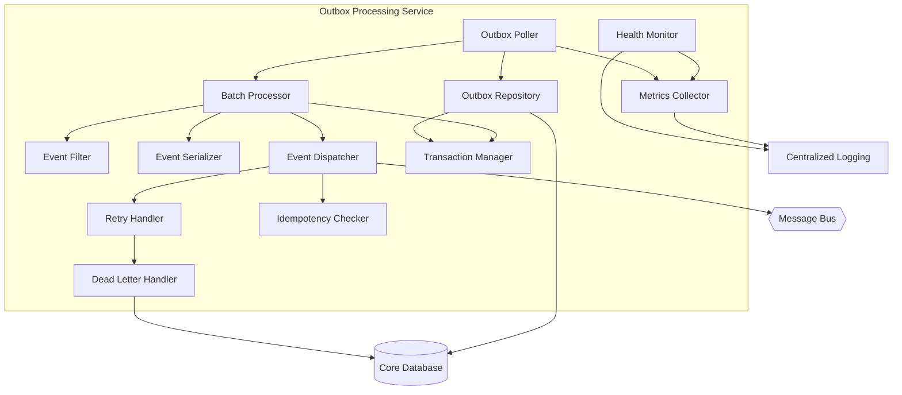

# Outbox Processing Service

## C3 — Components

### Outbox Poller (Scheduler)
Periodically polls the outbox table for unpublished domain events and triggers batch processing

### Batch Processor (Application Service)
Processes outbox events in configurable batches for efficient throughput

### Event Filter (Domain Service)
Filters and validates events before dispatch to ensure data quality

### Event Serializer (Infrastructure)
Serializes domain events to JSON format for message broker publishing

### Event Dispatcher (Integration Adapter)
Routes domain events to appropriate message broker topics based on event type

### Outbox Repository (Repository)
Data access component for outbox event records

### Retry Handler (Infrastructure)
Implements exponential backoff and retry logic for failed event deliveries

### Dead Letter Handler (Infrastructure)
Handles events that exceed retry limits by moving them to dead letter storage

### Idempotency Checker (Domain Service)
Ensures at-least-once delivery semantics with deduplication

### Transaction Manager (Infrastructure)
Manages transactional boundaries for outbox operations

### Health Monitor (Infrastructure)
Exposes health and readiness endpoints for operational monitoring

### Metrics Collector (Infrastructure)
Collects and exposes processing metrics for observability


## C3 — Summary

The Outbox Processing Service is an infrastructure component implementing the Transactional Outbox pattern for reliable domain event publishing. It ensures that domain events generated by application modules are reliably delivered to the message broker with at-least-once delivery semantics. The service polls the outbox table in the core database, processes events in batches, serializes them, and publishes to the internal message bus while maintaining idempotency and handling failures through retry mechanisms and dead letter queues.

## C3 — Insights

- Implements the Transactional Outbox pattern to ensure reliable event delivery without distributed transactions
- Uses batch processing for efficient handling of multiple pending events
- Provides retry logic with exponential backoff to handle transient failures gracefully
- Dead letter handling ensures problematic events are captured for manual intervention
- Idempotency checking prevents duplicate event processing by downstream consumers
- Health monitoring and metrics collection enable observability and operational alerting
- Transaction management ensures atomicity between reading events and marking them as processed
- Event filtering validates events before dispatch to catch malformed data early
- Designed for horizontal scaling with partition-aware polling strategies
- Supports multiple event types from various domain modules through generic event serialization

## C3 — Interfaces

### Outbox Polling Interface (Spring Data JPA)
Internal interface for polling and fetching pending outbox events from the database

- fetchPendingEvents(batchSize, partitionId)
- markEventAsProcessed(eventId)
- markEventAsFailed(eventId, errorDetails)
- getEventsByStatus(status)

### Event Publishing Interface (AMQP/RabbitMQ)
Interface for publishing domain events to the message broker

- publishEvent(event, topic)
- publishBatch(events, topic)
- confirmDelivery(correlationId)

### Health Check API (REST API)
REST API exposing health and readiness status for Kubernetes probes

- GET /actuator/health
- GET /actuator/health/liveness
- GET /actuator/health/readiness

### Metrics API (REST API/Prometheus)
Prometheus-compatible metrics endpoint for monitoring

- GET /actuator/prometheus
- GET /actuator/metrics

### Dead Letter Interface (Spring Data JPA)
Interface for managing dead letter events that failed processing

- storeDeadLetterEvent(event, error)
- getDeadLetterEvents()
- retryDeadLetterEvent(eventId)


## C3 — Relationships

- outbox-poller -> outbox-repository
- outbox-poller -> batch-processor
- batch-processor -> event-filter
- batch-processor -> event-serializer
- batch-processor -> event-dispatcher
- event-dispatcher -> retry-handler
- retry-handler -> dead-letter-handler
- event-dispatcher -> idempotency-checker
- batch-processor -> transaction-manager
- outbox-repository -> db-core
- event-dispatcher -> bus-01
- dead-letter-handler -> db-core
- metrics-collector -> log-01

## C3 — External dependencies

- Unnamed dependency: Primary database containing the outbox table with pending domain events
- Unnamed dependency: Message broker for publishing domain events to downstream consumers
- Unnamed dependency: Centralized logging and monitoring system for observability

## C3 — Diagram



## C4 — Classes

- OutboxMessage
- OutboxStatus
- OutboxEventMetadata
- OutboxRepository
- MessagePublisher
- OutboxProcessingService
- OutboxCleanupService
- OutboxMonitoringService
- OutboxMessageFactory
- JpaOutboxRepository
- RabbitMQMessagePublisher
- KafkaMessagePublisher
- OutboxScheduler
- OutboxAdminController
- OutboxHealthIndicator
- OutboxConfiguration
- OutboxProperties

## C4 — Summary

The Outbox Processing Service (SVC-002) implements the Transactional Outbox pattern to ensure reliable event publishing with at-least-once delivery guarantees. The service follows Hexagonal Architecture with clear separation between domain, application, infrastructure, and presentation layers. Core components include the OutboxMessage entity representing events to be published, the OutboxProcessingService that orchestrates message processing with retry logic, and pluggable MessagePublisher adapters supporting both RabbitMQ and Kafka. The OutboxScheduler uses Spring Scheduling with distributed locking (ShedLock) for clustered deployments. Administrative endpoints and health indicators provide operational visibility into outbox status and metrics.

## C4 — Insights

- Implements Transactional Outbox pattern (PAT-04) ensuring atomicity between database writes and event publishing - events are stored in the same transaction as domain changes, then asynchronously published
- Follows Hexagonal/Ports-and-Adapters architecture (PAT-02) with MessagePublisher port allowing easy swapping between RabbitMQ and Kafka adapters without changing core logic
- Uses Background Job/Worker pattern (PAT-10) with OutboxScheduler for periodic processing, supporting distributed locking via ShedLock for safe multi-instance deployment
- Implements retry with exponential backoff and dead-letter queue for poison messages, ensuring message delivery reliability while preventing infinite retry loops
- Provides comprehensive observability via OutboxMonitoringService with Micrometer metrics integration, OutboxHealthIndicator for Spring Boot Actuator, and correlation ID propagation for distributed tracing (PAT-12)
- Supports CQRS-lite pattern (PAT-03) by decoupling write operations from eventual consistency of downstream read models updated via published events
- Domain entity OutboxMessage encapsulates state transitions (PENDING→PROCESSING→COMPLETED/FAILED→DEAD_LETTER) with rich behavior methods following DDD principles (PAT-01)
- Configuration externalized via OutboxProperties with Spring Boot ConfigurationProperties, enabling environment-specific tuning of batch sizes, retry policies, and cleanup retention

## C4 — Methods

- **OutboxProcessingService.?** — Main processing loop that claims pending messages in batches, publishes them to the message broker, and updates their status. Returns count of successfully processed messages.
- **OutboxProcessingService.?** — Attempts to publish a single message with exponential backoff retry. Returns true if successful, false if all retries exhausted.
- **OutboxProcessingService.?** — Handles publish failures by incrementing retry count, recording error details, and potentially moving to dead-letter if max retries exceeded.
- **OutboxProcessingService.?** — Resets FAILED messages back to PENDING status for reprocessing. Used for manual recovery of transient failures.
- **OutboxCleanupService.?** — Deletes COMPLETED messages older than retention period. Returns count of deleted records.
- **OutboxMonitoringService.?** — Aggregates current outbox statistics including counts by status and average processing time into a metrics DTO.
- **JpaOutboxRepository.?** — Retrieves pending messages using SELECT FOR UPDATE SKIP LOCKED for safe concurrent claiming across multiple instances.
- **RabbitMQMessagePublisher.?** — Publishes message to RabbitMQ exchange with publisher confirms. Returns future that completes when broker acknowledges receipt.
- **KafkaMessagePublisher.?** — Publishes message to Kafka topic resolved by TopicResolver. Uses idempotent producer for exactly-once semantics.
- **OutboxScheduler.?** — Scheduled method triggered by cron expression. Acquires distributed lock before delegating to OutboxProcessingService.
- **OutboxAdminController.?** — REST endpoint returning current outbox metrics and health status for operational dashboards.
- **OutboxAdminController.?** — REST endpoint to manually trigger retry of a specific failed message by ID.
- **OutboxMessage.?** — Domain method transitioning message status to COMPLETED and setting processedAt timestamp.
- **OutboxMessage.?** — Domain method checking if message can be retried based on current retry count vs max attempts configuration.

## C4 — Data structures

- OutboxMessage: Core domain entity representing a message in the transactional outbox. Payload contains serialized event data. Version field supports optimistic locking for concurrent access.
- OutboxStatus: Enumeration of possible outbox message states representing the lifecycle from creation through successful delivery or terminal failure.
- OutboxEventMetadata: Immutable metadata attached to each outbox message for distributed tracing and event correlation across services.
- OutboxMessageDTO: Data transfer object for API responses, excluding sensitive payload content and internal fields.
- OutboxMetricsDTO: Aggregated metrics DTO for monitoring dashboards and health checks.
- OutboxProperties: Externalized configuration properties bound via @ConfigurationProperties for environment-specific tuning.

## C4 — Code relationships

- OutboxProcessingService depends on OutboxRepository port for persistence operations. Injected via constructor for testability.
- OutboxProcessingService depends on MessagePublisher port for broker communication. Concrete adapter selected by configuration.
- JpaOutboxRepository is the infrastructure adapter implementing the OutboxRepository domain port using Spring Data JPA.
- RabbitMQ adapter implementing MessagePublisher port. Conditionally instantiated when publisherType=rabbitmq.
- Kafka adapter implementing MessagePublisher port. Conditionally instantiated when publisherType=kafka.
- Scheduler triggers processing service methods on configured schedule with distributed lock protection.
- Scheduler triggers cleanup service for periodic housekeeping of processed and failed messages.
- REST controller delegates administrative operations to processing service for manual interventions.
- REST controller queries monitoring service for status and metrics endpoints.
- Health indicator queries monitoring service to determine health status based on pending message thresholds.
- OutboxMessage contains OutboxStatus as its lifecycle state attribute.
- OutboxMessage contains embedded metadata for tracing and correlation.
- Configuration class reads externalized properties to configure service beans.
- Factory creates properly initialized OutboxMessage instances from domain events.

## C4 — Diagram

```mermaid
%%{init: {'theme': 'base', 'themeVariables': { 'primaryColor': '#EBF5FB', 'secondaryColor': '#FDEDEC'}}}%%
classDiagram
    direction TB

    %% Domain Layer
    class OutboxMessage {
        <<Entity>>
        -UUID id
        -String aggregateId
        -String aggregateType
        -String eventType
        -String payload
        -Instant createdAt
        -Instant processedAt
        -OutboxStatus status
        -int retryCount
        -String lastError
        -String correlationId
        +markAsProcessed() void
        +markAsFailed(String error) void
        +incrementRetry() void
        +isRetryable() boolean
    }

    class OutboxStatus {
        <<Enumeration>>
        PENDING
        PROCESSING
        COMPLETED
        FAILED
        DEAD_LETTER
    }

    class OutboxEventMetadata {
        <<ValueObject>>
        -UUID eventId
        -Instant timestamp
        -String source
        -String correlationId
        -String causationId
        +toHeaders() Map~String,Object~
    }

    class OutboxRepository {
        <<Interface>>
        +findPendingMessages(int limit) List~OutboxMessage~
        +findByAggregateId(String aggregateId) List~OutboxMessage~
        +save(OutboxMessage message) OutboxMessage
        +updateStatus(UUID id, OutboxStatus status) void
        +findFailedMessages() List~OutboxMessage~
        +moveToDeadLetter(UUID id) void
        +countByStatus(OutboxStatus status) long
    }

    class MessagePublisher {
        <<Interface>>
        +publish(OutboxMessage message) CompletableFuture~Void~
        +publishBatch(List~OutboxMessage~ messages) CompletableFuture~Void~
    }

    %% Application Layer
    class OutboxProcessingService {
        <<Service>>
        -OutboxRepository outboxRepository
        -MessagePublisher messagePublisher
        -MeterRegistry meterRegistry
        -TransactionTemplate transactionTemplate
        +processOutboxMessages() int
        +processSingleMessage(UUID id) boolean
        +retryFailedMessages() int
        -publishWithRetry(OutboxMessage message) boolean
        -handlePublishFailure(OutboxMessage message, Exception ex) void
    }

    class OutboxCleanupService {
        <<Service>>
        -OutboxRepository outboxRepository
        -int retentionDays
        +cleanupProcessedMessages() int
        +archiveOldMessages() int
        +moveToDeadLetter() int
    }

    class OutboxMonitoringService {
        <<Service>>
        -OutboxRepository outboxRepository
        -MeterRegistry meterRegistry
        +getOutboxMetrics() OutboxMetricsDTO
        +getPendingCount() long
        +getFailedCount() long
        +getProcessingRate() double
    }

    class OutboxMessageDTO {
        <<DTO>>
        +UUID id
        +String aggregateId
        +String aggregateType
        +String eventType
        +String status
        +Instant createdAt
        +Instant processedAt
        +int retryCount
    }

    class OutboxMetricsDTO {
        <<DTO>>
        +long pendingCount
        +long processingCount
        +long completedCount
        +long failedCount
        +long deadLetterCount
        +double avgProcessingTimeMs
    }

    %% Infrastructure Layer
    class JpaOutboxRepository {
        <<Repository>>
        -EntityManager entityManager
        +findPendingMessages(int limit) List~OutboxMessage~
        +save(OutboxMessage message) OutboxMessage
        +updateStatus(UUID id, OutboxStatus status) void
    }

    class RabbitMQMessagePublisher {
        <<Adapter>>
        -RabbitTemplate rabbitTemplate
        -String exchangeName
        +publish(OutboxMessage message) CompletableFuture~Void~
        -buildRabbitMessage(OutboxMessage outbox) Message
        -determineRoutingKey(OutboxMessage message) String
    }

    class KafkaMessagePublisher {
        <<Adapter>>
        -KafkaTemplate kafkaTemplate
        -TopicResolver topicResolver
        +publish(OutboxMessage message) CompletableFuture~Void~
        -buildProducerRecord(OutboxMessage message) ProducerRecord
    }

    class OutboxScheduler {
        <<Scheduler>>
        -OutboxProcessingService outboxProcessingService
        -OutboxCleanupService outboxCleanupService
        +processOutboxScheduled() void
        +cleanupScheduled() void
        +retryFailedScheduled() void
    }

    %% Presentation Layer
    class OutboxAdminController {
        <<RestController>>
        -OutboxProcessingService outboxProcessingService
        -OutboxMonitoringService outboxMonitoringService
        +getOutboxStatus() ResponseEntity~OutboxMetricsDTO~
        +getPendingMessages(int page, int size) ResponseEntity~Page~
        +retryMessage(UUID id) ResponseEntity~Void~
        +retryAllFailed() ResponseEntity~Integer~
    }

    class OutboxHealthIndicator {
        <<Component>>
        -OutboxMonitoringService outboxMonitoringService
        -int pendingThreshold
        +health() Health
    }

    %% Configuration
    class OutboxConfiguration {
        <<Configuration>>
        -int batchSize
        -int retryMaxAttempts
        +outboxProcessingService() OutboxProcessingService
        +messagePublisher() MessagePublisher
    }

    class OutboxProperties {
        <<ConfigurationProperties>>
        +int batchSize
        +String schedulerCron
        +int retryMaxAttempts
        +long retryBackoffMs
        +int cleanupRetentionDays
        +String publisherType
    }

    %% Relationships
    OutboxMessage --> OutboxStatus : uses
    OutboxMessage --> OutboxEventMetadata : contains

    JpaOutboxRepository ..|> OutboxRepository : implements
    RabbitMQMessagePublisher ..|> MessagePublisher : implements
    KafkaMessagePublisher ..|> MessagePublisher : implements

    OutboxProcessingService --> OutboxRepository : uses
    OutboxProcessingService --> MessagePublisher : uses

    OutboxCleanupService --> OutboxRepository : uses
    OutboxMonitoringService --> OutboxRepository : queries

    OutboxScheduler --> OutboxProcessingService : triggers
    OutboxScheduler --> OutboxCleanupService : triggers

    OutboxAdminController --> OutboxProcessingService : delegates
    OutboxAdminController --> OutboxMonitoringService : queries

    OutboxHealthIndicator --> OutboxMonitoringService : checks

    OutboxConfiguration --> OutboxProperties : reads
```



## API specification — Endpoints

### GET /api/v1/outbox/entries
List outbox entries with optional filtering by status, event type, and date range

### GET /api/v1/outbox/entries/{entryId}
Retrieve a specific outbox entry by ID

### POST /api/v1/outbox/entries/{entryId}/retry
Manually retry processing a failed outbox entry

### POST /api/v1/outbox/entries/{entryId}/skip
Mark a failed outbox entry as skipped (will not be retried)

### GET /api/v1/outbox/stats
Get outbox processing statistics

### POST /api/v1/outbox/processor/start
Manually trigger the outbox processor to start processing pending entries

### POST /api/v1/outbox/processor/stop
Stop the outbox processor gracefully

### GET /api/v1/outbox/processor/status
Get the current status of the outbox processor

### GET /health
Health check endpoint for the outbox processing service

### GET /health/ready
Readiness check endpoint

### GET /health/live
Liveness check endpoint

### GET /metrics
Prometheus metrics endpoint


## API specification — Summary

The Outbox Processing Service API provides endpoints for managing and monitoring the transactional outbox pattern implementation. This infrastructure service is responsible for reliably publishing domain events from the outbox table to the message broker (RabbitMQ/Kafka), ensuring at-least-once delivery semantics. The API exposes endpoints for: (1) listing and viewing outbox entries with filtering by status, event type, and date range; (2) manually retrying failed entries or marking them as skipped; (3) retrieving processing statistics; (4) controlling the processor lifecycle (start/stop); and (5) health and metrics endpoints for observability. Authentication is via JWT tokens from the central IdP, with role-based access control distinguishing between read-only operators and full administrators.

## API specification — Insights

- The Outbox Processing Service is an infrastructure component implementing the Transactional Outbox pattern for reliable event publishing. It reads events written atomically with business transactions and publishes them to the message broker.
- The API is primarily administrative/operational - most interactions with the outbox happen internally via database writes from APP-* services; this API provides visibility and manual intervention capabilities.
- Health endpoints are unauthenticated to support Kubernetes probes. The /metrics endpoint is also unauthenticated but should be protected at the infrastructure level (network policies, service mesh).
- The processor control endpoints (start/stop) require ADMIN role as they can impact system-wide event delivery. Retry operations are available to SYSTEM_OPERATOR role for day-to-day operations.
- Statistics endpoint provides operational insights including counts by status and event type, useful for dashboards and alerting on processing backlogs or failure rates.
- The skip functionality requires documenting a reason, creating an audit trail for entries that are intentionally not processed (e.g., due to known issues with specific events).
- Pagination is enforced on the list endpoint with a maximum page size of 100 to prevent performance issues when querying large outbox tables.
- The service integrates with OpenTelemetry for distributed tracing - correlation IDs flow through from upstream services and are included in error responses for troubleshooting.
- Rate limiting is applied to prevent abuse, with stricter limits on administrative endpoints that could impact system stability.
- The outbox table schema supports exponential backoff retry logic with configurable max retries, next retry time tracking, and error message storage for debugging.

API version: 1.0.0

## API specification — Data models

### OutboxEntry
- `id`: {'type': 'string', 'format': 'uuid', 'description': 'Unique identifier for the outbox entry'}
- `status`: {'enum': ['PENDING', 'PROCESSING', 'COMPLETED', 'FAILED', 'SKIPPED'], 'type': 'string', 'description': 'Current processing status'}
- `payload`: {'type': 'string', 'description': 'JSON-serialized event payload'}
- `metadata`: {'type': 'object', 'description': 'Additional metadata for the event', 'additionalProperties': True}
- `createdAt`: {'type': 'string', 'format': 'date-time', 'description': 'Timestamp when the entry was created'}
- `eventType`: {'type': 'string', 'description': 'Type of the domain event (e.g., TrainerCreated, WorkshopScheduled)'}
- `lastError`: {'type': 'string', 'description': 'Last error message if processing failed'}
- `maxRetries`: {'type': 'integer', 'description': 'Maximum allowed retry attempts'}
- `retryCount`: {'type': 'integer', 'description': 'Number of retry attempts'}
- `aggregateId`: {'type': 'string', 'description': 'Identifier of the aggregate instance'}
- `nextRetryAt`: {'type': 'string', 'format': 'date-time', 'description': 'Scheduled time for next retry attempt'}
- `processedAt`: {'type': 'string', 'format': 'date-time', 'description': 'Timestamp when the entry was successfully processed'}
- `aggregateType`: {'type': 'string', 'description': 'Type of the aggregate that produced this event (e.g., Trainer, Workshop, Allocation)'}
- `correlationId`: {'type': 'string', 'description': 'Correlation ID for distributed tracing'}

### OutboxEntryResponse
- `id`: {'type': 'string', 'format': 'uuid'}
- `status`: {'type': 'string'}
- `payload`: {'type': 'object', 'description': 'Deserialized event payload'}
- `createdAt`: {'type': 'string', 'format': 'date-time'}
- `eventType`: {'type': 'string'}
- `lastError`: {'type': 'string'}
- `maxRetries`: {'type': 'integer'}
- `retryCount`: {'type': 'integer'}
- `aggregateId`: {'type': 'string'}
- `nextRetryAt`: {'type': 'string', 'format': 'date-time'}
- `processedAt`: {'type': 'string', 'format': 'date-time'}
- `aggregateType`: {'type': 'string'}
- `correlationId`: {'type': 'string'}

### PagedOutboxEntriesResponse
- `last`: {'type': 'boolean', 'description': 'Is this the last page'}
- `page`: {'type': 'integer', 'description': 'Current page number'}
- `size`: {'type': 'integer', 'description': 'Page size'}
- `first`: {'type': 'boolean', 'description': 'Is this the first page'}
- `content`: {'type': 'array', 'items': {'$ref': '#/components/schemas/OutboxEntryResponse'}}
- `totalPages`: {'type': 'integer', 'description': 'Total number of pages'}
- `totalElements`: {'type': 'integer', 'description': 'Total number of elements'}

### OutboxStatistics
- `toDate`: {'type': 'string', 'format': 'date-time'}
- `fromDate`: {'type': 'string', 'format': 'date-time'}
- `failedCount`: {'type': 'integer', 'description': 'Number of failed entries'}
- `pendingCount`: {'type': 'integer', 'description': 'Number of pending entries'}
- `skippedCount`: {'type': 'integer', 'description': 'Number of skipped entries'}
- `totalEntries`: {'type': 'integer', 'description': 'Total number of outbox entries'}
- `completedCount`: {'type': 'integer', 'description': 'Number of successfully processed entries'}
- `processingCount`: {'type': 'integer', 'description': 'Number of entries currently being processed'}
- `entriesByEventType`: {'type': 'object', 'description': 'Count of entries by event type', 'additionalProperties': {'type': 'integer'}}
- `averageProcessingTimeMs`: {'type': 'number', 'description': 'Average processing time in milliseconds'}

### ProcessorStatus
- `running`: {'type': 'boolean', 'description': 'Whether the processor is currently running'}
- `lastRunAt`: {'type': 'string', 'format': 'date-time', 'description': 'Timestamp of the last processing run'}
- `currentBatchSize`: {'type': 'integer', 'description': 'Current batch size configuration'}
- `pollingIntervalMs`: {'type': 'integer', 'description': 'Polling interval in milliseconds'}
- `nextScheduledRunAt`: {'type': 'string', 'format': 'date-time', 'description': 'Timestamp of the next scheduled run'}
- `entriesProcessedLastRun`: {'type': 'integer', 'description': 'Number of entries processed in the last run'}

### SkipEntryRequest
- `reason`: {'type': 'string', 'maxLength': 500, 'minLength': 1, 'description': 'Reason for skipping the entry'}

### RetryResponse
- `status`: {'type': 'string'}
- `entryId`: {'type': 'string', 'format': 'uuid'}
- `message`: {'type': 'string'}
- `scheduledAt`: {'type': 'string', 'format': 'date-time'}

### HealthResponse
- `status`: {'enum': ['UP', 'DOWN'], 'type': 'string'}
- `timestamp`: {'type': 'string', 'format': 'date-time'}
- `components`: {'type': 'object', 'properties': {'database': {'type': 'object', 'properties': {'status': {'type': 'string'}}}, 'processor': {'type': 'object', 'properties': {'status': {'type': 'string'}}}, 'messageBroker': {'type': 'object', 'properties': {'status': {'type': 'string'}}}}}

### ErrorResponse
- `path`: {'type': 'string', 'description': 'Request path'}
- `error`: {'type': 'string', 'description': 'Error type'}
- `status`: {'type': 'integer', 'description': 'HTTP status code'}
- `message`: {'type': 'string', 'description': 'Error message'}
- `timestamp`: {'type': 'string', 'format': 'date-time'}
- `correlationId`: {'type': 'string', 'description': 'Correlation ID for tracing'}


## API specification — Authentication

- Scopes: outbox:read, outbox:admin, outbox:manage

## API specification — Error handling

- 400 Bad Request: Returned when request parameters or body fail validation. Response includes field-level validation errors.
- 401 Unauthorized: Returned when no valid authentication token is provided or token is expired.
- 403 Forbidden: Returned when the authenticated user lacks required roles or scopes for the operation.
- 404 Not Found: Returned when the requested outbox entry does not exist.
- 409 Conflict: Returned when an operation conflicts with current state (e.g., starting processor when already running, retrying a non-failed entry).
- 422 Unprocessable Entity: Returned when the request is syntactically valid but semantically incorrect (e.g., skipping an entry that is not in FAILED status).
- 429 Too Many Requests: Returned when rate limit is exceeded. Includes Retry-After header.
- 500 Internal Server Error: Returned for unexpected server errors. Includes correlation ID for troubleshooting.
- 503 Service Unavailable: Returned when the service or its dependencies (database, message broker) are unavailable.
- All error responses follow the ErrorResponse schema with timestamp, status, error, message, path, and correlationId fields.
- Validation errors include a 'fieldErrors' array with field name, rejected value, and validation message for each invalid field.

## OpenAPI specification

```json
openapi: 3.0.3
info:
  title: Outbox Processing Service API
  description: |
    API for managing and monitoring the transactional outbox pattern implementation.
    This service processes domain events stored in an outbox table and publishes them
    to the message broker (RabbitMQ/Kafka) ensuring at-least-once delivery semantics.
  version: 1.0.0
  contact:
    name: TMS Platform Team
servers:
  - url: /api/v1
    description: API v1 base path
paths:
  /outbox/entries:
    get:
      tags:
        - Outbox Entries
      summary: List outbox entries
      description: Retrieve a paginated list of outbox entries with optional filtering
      operationId: listOutboxEntries
      parameters:
        - name: status
          in: query
          schema:
            type: string
            enum: [PENDING, PROCESSING, COMPLETED, FAILED, SKIPPED]
          description: Filter by processing status
        - name: eventType
          in: query
          schema:
            type: string
          description: Filter by event type
        - name: fromDate
          in: query
          schema:
            type: string
            format: date-time
          description: Filter entries created from this date
        - name: toDate
          in: query
          schema:
            type: string
            format: date-time
          description: Filter entries created until this date
        - name: page
          in: query
          schema:
            type: integer
            default: 0
            minimum: 0
          description: Page number (zero-based)
        - name: size
          in: query
          schema:
            type: integer
            default: 20
            minimum: 1
            maximum: 100
          description: Page size
      responses:
        '200':
          description: Paginated list of outbox entries
          content:
            application/json:
              schema:
                $ref: '#/components/schemas/PagedOutboxEntriesResponse'
        '400':
          description: Invalid query parameters
          content:
            application/json:
              schema:
                $ref: '#/components/schemas/ErrorResponse'
        '401':
          description: Unauthorized
          content:
            application/json:
              schema:
                $ref: '#/components/schemas/ErrorResponse'
        '403':
          description: Forbidden
          content:
            application/json:
              schema:
                $ref: '#/components/schemas/ErrorResponse'
      security:
        - bearerAuth: [outbox:read]
  /outbox/entries/{entryId}:
    get:
      tags:
        - Outbox Entries
      summary: Get outbox entry by ID
      description: Retrieve details of a specific outbox entry
      operationId: getOutboxEntry
      parameters:
        - name: entryId
          in: path
          required: true
          schema:
            type: string
            format: uuid
          description: Unique identifier of the outbox entry
      responses:
        '200':
          description: Outbox entry details
          content:
            application/json:
              schema:
                $ref: '#/components/schemas/OutboxEntryResponse'
        '401':
          description: Unauthorized
          content:
            application/json:
              schema:
                $ref: '#/components/schemas/ErrorResponse'
        '403':
          description: Forbidden
          content:
            application/json:
              schema:
                $ref: '#/components/schemas/ErrorResponse'
        '404':
          description: Entry not found
          content:
            application/json:
              schema:
                $ref: '#/components/schemas/ErrorResponse'
      security:
        - bearerAuth: [outbox:read]
  /outbox/entries/{entryId}/retry:
    post:
      tags:
        - Outbox Entries
      summary: Retry failed entry
      description: Manually trigger retry for a failed outbox entry
      operationId: retryOutboxEntry
      parameters:
        - name: entryId
          in: path
          required: true
          schema:
            type: string
            format: uuid
          description: Unique identifier of the outbox entry to retry
      responses:
        '202':
          description: Retry initiated
          content:
            application/json:
              schema:
                $ref: '#/components/schemas/RetryResponse'
        '400':
          description: Entry is not in a retryable state
          content:
            application/json:
              schema:
                $ref: '#/components/schemas/ErrorResponse'
        '401':
          description: Unauthorized
          content:
            application/json:
              schema:
                $ref: '#/components/schemas/ErrorResponse'
        '403':
          description: Forbidden
          content:
            application/json:
              schema:
                $ref: '#/components/schemas/ErrorResponse'
        '404':
          description: Entry not found
          content:
            application/json:
              schema:
                $ref: '#/components/schemas/ErrorResponse'
      security:
        - bearerAuth: [outbox:manage]
  /outbox/entries/{entryId}/skip:
    post:
      tags:
        - Outbox Entries
      summary: Skip failed entry
      description: Mark a failed outbox entry as skipped (will not be retried)
      operationId: skipOutboxEntry
      parameters:
        - name: entryId
          in: path
          required: true
          schema:
            type: string
            format: uuid
          description: Unique identifier of the outbox entry to skip
      requestBody:
        required: true
        content:
          application/json:
            schema:
              $ref: '#/components/schemas/SkipEntryRequest'
      responses:
        '200':
          description: Entry marked as skipped
          content:
            application/json:
              schema:
                $ref: '#/components/schemas/OutboxEntryResponse'
        '400':
          description: Entry cannot be skipped
          content:
            application/json:
              schema:
                $ref: '#/components/schemas/ErrorResponse'
        '401':
          description: Unauthorized
          content:
            application/json:
              schema:
                $ref: '#/components/schemas/ErrorResponse'
        '403':
          description: Forbidden
          content:
            application/json:
              schema:
                $ref: '#/components/schemas/ErrorResponse'
        '404':
          description: Entry not found
          content:
            application/json:
              schema:
                $ref: '#/components/schemas/ErrorResponse'
      security:
        - bearerAuth: [outbox:admin]
  /outbox/stats:
    get:
      tags:
        - Statistics
      summary: Get outbox statistics
      description: Retrieve processing statistics for the outbox
      operationId: getOutboxStatistics
      parameters:
        - name: fromDate
          in: query
          schema:
            type: string
            format: date-time
          description: Statistics from this date
        - name: toDate
          in: query
          schema:
            type: string
            format: date-time
          description: Statistics until this date
      responses:
        '200':
          description: Outbox statistics
          content:
            application/json:
              schema:
                $ref: '#/components/schemas/OutboxStatistics'
        '401':
          description: Unauthorized
          content:
            application/json:
              schema:
                $ref: '#/components/schemas/ErrorResponse'
        '403':
          description: Forbidden
          content:
            application/json:
              schema:
                $ref: '#/components/schemas/Erro

_(truncated -- content exceeds the reference file size budget)_
```
