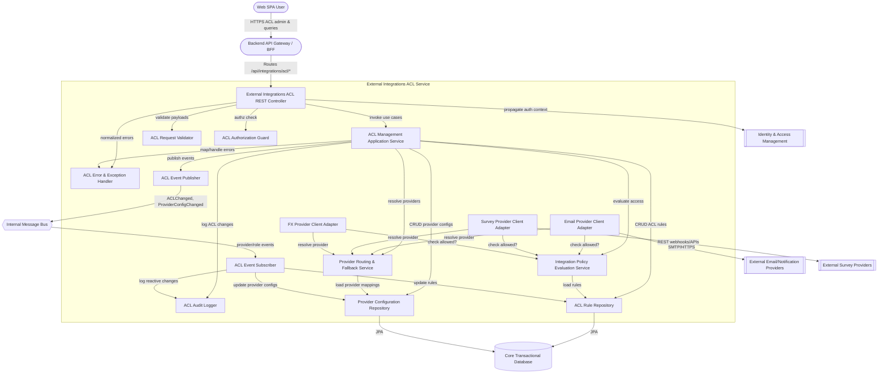

# External Integrations ACL Service

## C3 — Summary

C3 component diagram for SVC-003 External Integrations ACL Service, modeling REST-facing controllers, ACL-centric application and domain services, validation/authorization, repositories, integration adapters, and messaging interactions that govern controlled access to external email, survey, and FX providers within the modular monolith.

## C3 — Insights

- The External Integrations ACL Service centralizes policy evaluation and provider routing so core modules (Feedback, Notifications, FX) do not embed vendor-specific or rule-specific logic.
- ACL rules and provider configurations are persisted via dedicated repositories, ensuring clear ownership of integration governance data within the shared transactional database.
- Inbound usage flows through a single REST controller plus an application service, which enforces validation, authorization, auditing, and event publication around ACL changes.
- Dedicated client adapters for email, survey, and FX providers depend on policy evaluation and routing services, enabling pluggable providers and feature-level access control without leaking external API details.
- Messaging integration via ACL Event Publisher/Subscriber allows other modules to react to ACL and provider configuration changes while also allowing ACL to adapt to upstream provider lifecycle events.
- Cross-cutting components (authorization guard, validator, audit logger, error handler) keep controllers and application services focused on orchestration and domain logic, supporting SRP and easier evolution of policies.

## C3 — Interfaces

### External Integrations ACL Administration REST API (REST/JSON over HTTPS)
Administrative REST interface for creating, updating, deleting, and listing ACL rules and provider configurations controlling access to external integrations.

- GET /api/integrations/acl/rules
- POST /api/integrations/acl/rules
- PUT /api/integrations/acl/rules/{ruleId}
- DELETE /api/integrations/acl/rules/{ruleId}
- GET /api/integrations/acl/providers
- POST /api/integrations/acl/providers
- PUT /api/integrations/acl/providers/{providerId}

### External Integrations ACL Evaluation REST API (REST/JSON over HTTPS)
Internal-facing REST interface for evaluating whether a caller is allowed to invoke a particular external provider operation, returning an allow/deny decision and routed provider details.

- POST /api/integrations/acl/evaluate
- GET /api/integrations/acl/effective-rules?module={module}&operation={operation}

### ACL Rule Repository Interface (Spring Data JPA / PostgreSQL)
Data access interface for persisting and querying external integration ACL rules used during administration and policy evaluation flows.

- save(AclRule)
- findById(ruleId)
- findByModuleAndOperation(module, operation)
- search(criteria)
- deleteById(ruleId)

### Provider Configuration Repository Interface (Spring Data JPA / PostgreSQL)
Data access interface for managing provider configuration records, including logical provider names, routing policies, and credential references.

- save(ProviderConfig)
- findById(providerId)
- findByLogicalKey(logicalKey)
- findAllActive()
- deleteById(providerId)

### Integration Policy Evaluation Service Interface (In-process Java service)
Domain-level interface for evaluating ACL rules given caller context, module, provider type, and operation, returning an access decision and matched rules.

- evaluateAccess(context, module, providerType, operation)
- listEffectiveRules(context, module, operation)

### Provider Routing Service Interface (In-process Java service)
Domain-level interface for resolving the concrete provider configuration that should handle a logical external operation, including fallback when primary providers are unavailable or disallowed.

- resolveProvider(module, providerType, operation)
- listAvailableProviders(providerType)

### Email Provider Client Adapter Interface (Java adapter over SMTP/HTTPS clients)
Integration interface that upstream modules use to send ACL-governed email messages via the appropriate external email provider.

- sendEmail(messagePayload, context)
- checkEmailAllowed(context, operation)

### Survey Provider Client Adapter Interface (Java REST client adapter)
Integration interface that encapsulates ACL checks and provider routing for creating surveys, generating links, and performing survey operations with external providers.

- createSurvey(definition, context)
- generateSurveyLink(campaignId, context)
- checkSurveyOperationAllowed(context, operation)

### FX Provider Client Adapter Interface (Java REST client adapter)
Integration interface used by reporting modules to obtain ACL-authorized FX rate data and conversions from configured FX providers.

- getFxRates(baseCurrency, asOfDate, context)
- convertAmount(amount, fromCurrency, toCurrency, context)

### ACL Event Publisher Interface (RabbitMQ/Kafka producer via transactional outbox)
Messaging interface for publishing ACL and provider configuration lifecycle events so other modules can synchronize caches or adjust behavior.

- publishAclChangedEvent(aclRuleId, changeType)
- publishProviderConfigChangedEvent(providerId, changeType)

### ACL Event Subscriber Interface (RabbitMQ/Kafka consumer)
Messaging consumer interface for handling upstream events that may impact ACLs or provider configurations, such as provider decommission events or role model changes.

- onProviderDecommissioned(event)
- onRoleModelChanged(event)

### ACL Authorization Guard Interface (Spring Security policy/authorization component)
Security interface used by controllers and application services to verify that the current principal is allowed to perform ACL administration or evaluation operations.

- checkCanManageAclRules(authContext)
- checkCanManageProviderConfigs(authContext)
- checkCanEvaluateAcl(authContext)


## C3 — Relationships

- spa_user -> api_gw: SPA users invoke ACL management and inspection operations through the API gateway.
- api_gw -> ExtAclApiController: API gateway routes /api/integrations/acl/* requests into the External Integrations ACL REST controller.
- ExtAclApiController -> AclAuthorizationGuard: Controller verifies that the authenticated principal has rights to perform ACL administration or evaluation.
- ExtAclApiController -> AclRequestValidator: Controller validates request bodies and query parameters before executing ACL use cases.
- ExtAclApiController -> ExtAclAppService: Controller delegates ACL-related use cases (CRUD, evaluation, listing) to the application service.
- ExtAclApiController -> AclErrorHandler: Controller relies on centralized error handler to translate exceptions into consistent HTTP responses.
- ExtAclAppService -> IntegrationPolicyEvaluator: Application service calls the policy evaluator to compute access decisions based on ACL rules and context.
- ExtAclAppService -> ProviderRoutingService: Application service resolves which provider configuration should be used for a requested external operation.
- ExtAclAppService -> AclRuleRepository: Application service persists and queries ACL rule aggregates to support admin and evaluation operations.
- ExtAclAppService -> ProviderConfigRepository: Application service manages provider configuration entities backing routing and ACL checks.
- ExtAclAppService -> AclAuditLogger: Application service emits audit records for ACL and provider configuration changes as well as sensitive evaluations.
- ExtAclAppService -> AclEventPublisher: Application service publishes ACLChanged and ProviderConfigChanged events after successful transactions.
- IntegrationPolicyEvaluator -> AclRuleRepository: Policy evaluator loads ACL rules from the repository to compute effective access decisions.
- ProviderRoutingService -> ProviderConfigRepository: Provider routing service reads provider configuration data required to select and route to concrete providers.
- EmailClientAdapter -> IntegrationPolicyEvaluator: Email adapter invokes policy evaluation before performing outbound email operations.
- EmailClientAdapter -> ProviderRoutingService: Email adapter requests routed provider details for a logical email operation.
- SurveyClientAdapter -> IntegrationPolicyEvaluator: Survey adapter evaluates ACL rules before interacting with survey providers.
- SurveyClientAdapter -> ProviderRoutingService: Survey adapter determines which survey provider instance to call for a given operation.
- FxClientAdapter -> IntegrationPolicyEvaluator: FX adapter checks ACL policies to ensure FX operations are permitted.
- FxClientAdapter -> ProviderRoutingService: FX adapter asks routing service to select the right FX provider configuration.
- AclEventSubscriber -> AclRuleRepository: Event subscriber updates or validates ACL rules in response to upstream lifecycle events.
- AclEventSubscriber -> ProviderConfigRepository: Event subscriber adjusts provider configurations when receiving relevant system or provider events.
- AclEventSubscriber -> AclAuditLogger: Event subscriber records audits for reactive ACL and provider configuration changes caused by external events.
- ExtAclApiController -> auth01: Controller relies on IAM token validation and user claims propagated from the gateway for authentication and RBAC decisions.
- AclRuleRepository -> db_core: ACL rules are stored and queried in the shared core transactional database using JPA.
- ProviderConfigRepository -> db_core: Provider configuration data is persisted in the core transactional database.
- AclEventPublisher -> bus01: ACL event publisher sends ACLChanged and ProviderConfigChanged messages onto the internal message bus.
- bus01 -> AclEventSubscriber: Internal message bus delivers system and provider lifecycle events to the ACL event subscriber component.
- EmailClientAdapter -> ext_email: Email adapter sends ACL-authorized email messages through configured external email providers.
- SurveyClientAdapter -> ext_survey: Survey adapter performs ACL-governed REST calls and receives webhooks from external survey platforms.

## C3 — External dependencies

- Backend API Gateway / BFF: Routes SPA and client requests into the External Integrations ACL REST controller.
- Identity & Access Management: Central identity provider that authenticates users and issues tokens used for ACL administration and evaluation.
- Core Transactional Database: Shared relational database schema where ACL rules and provider configuration tables are stored.
- Internal Message Bus / Event Dispatcher: Broker used to carry ACLChanged, ProviderConfigChanged, and upstream lifecycle events to and from the ACL service.
- External Email/Notification Providers: Third-party or organizational email systems that ultimately deliver emails authorized by ACL policies.
- External Survey Providers: External survey platforms hosting feedback forms and receiving ACL-governed integration calls.

## C3 — Diagram



## C4 — Classes

- ExternalIntegrationAclAggregate
- PrincipalRef
- AclCondition
- AuditMetadata
- ExternalIntegrationAclEntity
- SpringDataExternalIntegrationAclRepository
- ExternalIntegrationAclRepositoryAdapter
- [REDACTED-AWS_SECRET_KEY]
- AclValidationService
- AclEvaluationService
- AclMethodSecurityAspect
- ExternalIntegrationAclController
- GlobalExceptionHandler
- AclMapper
- ExternalIntegrationAclEntityMapper
- ProviderCapabilitiesClient
- ExternalIntegrationsAclProperties

## C4 — Summary

Code-level C4 diagram for SVC-003 External Integrations ACL Service, showing core domain aggregate for ACL rules, application service orchestrating validation, persistence and auditing, repository adapters using Spring Data JPA and QueryDSL, security evaluation service and aspect for method-level enforcement, REST controller and DTOs for CRUD and search, plus configuration properties and provider capability integration port.

## C4 — Insights

- The ACL is modeled as a single aggregate root (ExternalIntegrationAclAggregate) encapsulating principals, provider, capability, effect and conditions, which aligns with DDD and keeps invariants (no duplicates, consistent validity window) inside the domain.
- A clear separation exists between write-side commands (Create/Update/DeleteIntegrationAclCommand) and read/search queries (AclSearchQuery, IntegrationAclDTO), which supports CQRS-lite while still using a single PostgreSQL database.
- Spring Data JPA repositories are wrapped by ExternalIntegrationAclRepositoryAdapter and ExternalIntegrationAclEntityMapper, enforcing the hexagonal ports-and-adapters pattern and preventing leakage of persistence concerns into the domain layer.
- AclEvaluationService and AclMethodSecurityAspect provide a reusable policy-based RBAC mechanism for external integrations, allowing other services to annotate outbound calls with @SecuredIntegration and have ACL checks applied consistently.
- Validation and audit concerns are handled by dedicated services (AclValidationService, AclAuditService) in the application layer rather than embedded in controllers or repositories, improving testability and keeping the REST API thin.
- The design uses value objects (PrincipalRef, AclCondition, AuditMetadata, AclEvaluationContext) to capture important concepts with correct equality and encapsulated logic, which reduces primitive obsession and clarifies business rules.
- Soft delete is supported at the persistence level via a deleted flag on ExternalIntegrationAclEntity and corresponding repository methods, which facilitates auditability and data retention policies without losing historical ACLs.
- Configuration is externalized through ExternalIntegrationsAclProperties, enabling feature toggles (enabled flag), sensible defaults (defaultValidity) and provider aliasing without code changes, supporting different environments and external provider mappings.
- ProviderCapabilitiesClient acts as an outbound port for discovering which providers and capabilities are available, allowing the ACL service to remain independent of concrete email/survey implementations and to support multiple providers over time.
- GlobalExceptionHandler centralizes error handling for not-found, validation, access-denied and generic errors, ensuring consistent API error contracts (ApiErrorResponse) and simplifying controller logic.

## C4 — Methods

- **[REDACTED-AWS_SECRET_KEY].create** — Validates and persists a new ACL aggregate, records audit information and returns a DTO for API consumption.
- **[REDACTED-AWS_SECRET_KEY].search** — Executes a paginated ACL search using the repository adapter and maps results to DTOs.
- **ExternalIntegrationAclRepositoryAdapter.load** — Loads an ACL aggregate for a specific tenant, throwing an exception if not found or soft-deleted.
- **ExternalIntegrationAclRepositoryAdapter.search** — Delegates to JPA/QueryDSL repository to execute multi-criteria ACL search and maps entities to aggregates.
- **AclValidationService.validateCreate** — Runs business validations for newly created ACLs, including tenant policies and uniqueness constraints.
- **AclValidationService.ensureNotDuplicate** — Checks for existing ACLs with the same provider, capability and principals and rejects duplicates.
- **AclEvaluationService.isAllowed** — Evaluates all active ACL rules for the given parameters to determine if access should be allowed or denied.
- **AclMethodSecurityAspect.aroundSecuredIntegrationCall** — Aspect that evaluates ACLs before proceeding with an outbound integration method, throwing AccessDeniedException on failure.
- **ExternalIntegrationAclController.createAcl** — HTTP POST endpoint to create a new ACL rule, mapping request to command and returning the created ACL representation.
- **ExternalIntegrationAclController.searchAcls** — HTTP GET endpoint for filtered, paginated listing of ACL rules.
- **ExternalIntegrationAclController.listProviderCapabilities** — HTTP GET endpoint listing supported external providers and their capabilities for ACL configuration UIs.
- **GlobalExceptionHandler.handleAclNotFound** — Maps missing ACL exceptions to a 404 NOT FOUND response with a structured error body.
- **ExternalIntegrationAclEntityMapper.toEntity** — Converts a domain aggregate to its JPA entity representation, including serializing principals and conditions to JSON.
- **AclMapper.toAggregate** — Creates a new domain aggregate from a create command, initializing value objects and defaults.
- **ProviderCapabilitiesClient.fetchCapabilities** — Retrieves the current list of external provider capabilities from an external registry or configuration source.

## C4 — Data structures

- ExternalIntegrationAclAggregate
- PrincipalRef
- AclCondition
- IntegrationAclDTO
- CreateIntegrationAclRequest
- IntegrationAclResponse
- ExternalIntegrationAclEntity
- CreateIntegrationAclCommand
- AclSearchQuery
- ExternalIntegrationsAclProperties

## C4 — Code relationships

- Controller delegates all ACL operations to the application service, keeping HTTP concerns separate from business logic.
- Application service uses the repository adapter as its persistence port for loading and saving ACL aggregates.
- Before persisting new or updated ACLs, the application service invokes validation to enforce business rules.
- After create/update/delete operations, the application service records audit events for traceability.
- Repository adapter delegates actual DB operations to Spring Data JPA interfaces, translating between domain and entity types.
- Repository adapter composes a mapper instance to convert between aggregates and entities, ensuring mapping is centralized.
- The entity is a persistence representation of the aggregate; mapping is handled by ExternalIntegrationAclEntityMapper.
- ACL evaluation loads applicable ACL aggregates via the repository adapter in order to compute allow/deny decisions.
- Aspect calls the evaluation service before executing outbound integration methods annotated with @SecuredIntegration.
- Controller uses the mapper to translate between DTOs/aggregates and HTTP request/response models.
- Application service queries available providers and capabilities through an outbound port to show valid options for ACLs.
- Exception handler builds ApiErrorResponse instances from exceptions to return consistent error payloads across the service.
- Configuration class enables binding of ACL properties and wires beans conditionally based on the enabled flag.

## C4 — Diagram

_(diagram omitted -- exceeds the reference file size budget)_

## API specification — Endpoints

### GET /api/v1/integration-acl
Returns a paginated list of External Integration ACL rules controlling which internal modules/roles may use which external providers and operations.

### GET /api/v1/integration-acl/{id}
Retrieve a single ACL rule by its identifier.

### POST /api/v1/integration-acl
Create a new External Integration ACL rule.

### PUT /api/v1/integration-acl/{id}
Replace an existing ACL rule. Uses optimistic locking via version field.

### PATCH /api/v1/integration-acl/{id}
Partially update mutable fields of an ACL entry, typically used for enabling/disabling or updating limits.

### DELETE /api/v1/integration-acl/{id}
Delete (or soft-delete, depending on implementation) an ACL rule. Typically allowed only for integration admins and system admins.

### POST /api/v1/integration-acl/evaluate
Internal/business operation endpoint for other backend modules (e.g., NOTIF-01, SURV-INT-01, FX-01) to check whether a given internal module, role, and context are permitted to call a specific external provider/operation right now. Intended for server-to-server calls via service accounts.

### GET /api/v1/integration-acl/export
Export all ACL entries as CSV or JSON for security review and audits. Potentially scheduled via JOB-01. Returns synchronous export for moderate volumes.

### GET /api/v1/integration-acl/info
Basic informational endpoint exposing build info, supported provider types, and max limits as understood by the ACL service.

### GET /actuator/health
Liveness/readiness health endpoint exposed by Spring Boot Actuator.

### GET /actuator/metrics
Spring Boot Actuator metrics endpoint (may be restricted to ops).


## API specification — Summary

External Integrations ACL Service (SVC-003) defines a focused REST API to manage and evaluate access control rules for outbound integrations (email, survey, FX, etc.) within the TMS platform. It exposes CRUD endpoints for ACL rules, an internal evaluation endpoint for other backend modules, and standard health/metrics endpoints, secured via OAuth2/OIDC bearer tokens and RBAC-aligned scopes.

## API specification — Insights

- Keep this service small and single-purpose: only manage ACL rules and evaluation for external integrations, leaving user/role management to AUTH-01 and APP-ADMIN.
- Use Spring Boot 3 with Spring Web and Spring Security; integrate with the platform’s OIDC provider to validate JWT access tokens and map scopes/roles.
- Back the IntegrationAclEntry with a PostgreSQL table using Spring Data JPA; define unique constraints across providerType, providerId, internalModule, operation, scope, environment to enforce non-duplicated rules.
- Implement optimistic locking via the version field; surface 409 Conflict on mismatched versions for PUT/PATCH updates.
- Log every create/update/delete of ACL entries to LOG-01 and/or DB-AUDIT for traceability, including who changed what and previous vs new values.
- For the evaluate endpoint, keep latency low and avoid DB hot spots by caching active rules per provider and internalModule in Redis, with short TTL and event-driven invalidation on changes.
- Enforce rate limiting at two layers when necessary: coarse-grained at API gateway based on OAuth2 client, and fine-grained per-rule (rateLimitPerMinute/dailyQuota) inside the evaluation logic.
- Standardize error payloads using ErrorResponse so the API Gateway / UI can consistently surface issues and map them to user-facing messages.
- Expose the /actuator/health endpoint without authentication for k8s liveness/readiness probes, but protect /actuator/metrics with authentication and network-level controls.
- Ship a Postman collection preconfigured with bearer auth and common example requests to help integrators and testers validate ACL rules and evaluation behavior early.

API version: 1.0.0

## API specification — Data models

### IntegrationAclEntry

### CreateIntegrationAclRequest

### UpdateIntegrationAclRequest

### PatchIntegrationAclRequest

### IntegrationAclPageResponse

### AclEvaluationRequest

### AclEvaluationResult

### IntegrationAclExportResponse

### ServiceInfo

### ErrorResponse

### ValidationError

### PostmanCollection


## API specification — Authentication

- Rate limiting: {'defaults': {'burst': 200, 'perMinute': 600}, 'strategy': 'Token bucket / leaky bucket via API gateway or Spring filter', 'perClientOverrides': 'May be configured per OAuth2 client or per ACL rule; enforced upstream or at business layer for evaluation endpoint.'}

## API specification — Error handling

- All endpoints return problem details as JSON using the ErrorResponse schema.
- 400 Bad Request is returned for malformed JSON, invalid query parameters, or business validation failures. Validation errors include a validationErrors array with per-field messages.
- 401 Unauthorized is returned when the Authorization header is missing, expired, or invalid.
- 403 Forbidden is returned when the authenticated principal lacks required scopes/roles for the endpoint.
- 404 Not Found is returned when the requested resource (e.g., ACL entry) does not exist.
- 409 Conflict is returned for optimistic locking failures (version mismatch) or when creating/updating a rule that would duplicate an existing key combination.
- 5xx errors indicate unexpected server conditions; 503 may be used when downstream dependencies (e.g., database) are unavailable.
- Correlation/tracing: when available, a traceId is populated in ErrorResponse and may correspond to OpenTelemetry trace IDs.

## OpenAPI specification

```json
openapi: 3.0.3
info:
  title: External Integrations ACL Service
  version: 1.0.0
  description: |
    External Integrations ACL Service (SVC-003) provides centralized access control
    for outbound integrations such as email providers, survey tools, and FX rate
    services. It exposes configuration CRUD endpoints for ACL rules and an
    evaluation endpoint for internal services to check if a given external call
    is permitted.
servers:
  - url: https://api.example.com
    description: Production server
  - url: https://api.sandbox.example.com
    description: Sandbox server
paths:
  /api/v1/integration-acl:
    get:
      summary: List external integration ACL entries
      operationId: listIntegrationAcl
      tags: [IntegrationACL]
      security:
        - oauth2:
            - tms.acl.read
      parameters:
        - name: providerType
          in: query
          required: false
          schema:
            type: string
            enum: [EMAIL, SURVEY, FX, OTHER]
          description: Filter by external provider type.
        - name: providerId
          in: query
          required: false
          schema:
            type: string
          description: Filter by concrete provider identifier.
        - name: internalModule
          in: query
          required: false
          schema:
            type: string
          description: Filter by internal calling module.
        - name: role
          in: query
          required: false
          schema:
            type: string
          description: Filter by required application role key.
        - name: enabled
          in: query
          required: false
          schema:
            type: boolean
          description: Filter by enabled flag.
        - name: page
          in: query
          required: false
          schema:
            type: integer
            minimum: 0
            default: 0
          description: Zero-based page index.
        - name: size
          in: query
          required: false
          schema:
            type: integer
            minimum: 1
            maximum: 200
            default: 20
          description: Page size.
        - name: sort
          in: query
          required: false
          schema:
            type: string
          description: Sort expression, e.g. `providerType,asc`.
      responses:
        '200':
          description: Page of ACL entries.
          content:
            application/json:
              schema:
                $ref: '#/components/schemas/IntegrationAclPageResponse'
        '400':
          description: Invalid query parameters.
          content:
            application/json:
              schema:
                $ref: '#/components/schemas/ErrorResponse'
        '401':
          description: Missing or invalid authentication.
          content:
            application/json:
              schema:
                $ref: '#/components/schemas/ErrorResponse'
        '403':
          description: Caller not authorized to list ACL entries.
          content:
            application/json:
              schema:
                $ref: '#/components/schemas/ErrorResponse'
    post:
      summary: Create ACL entry
      operationId: createIntegrationAcl
      tags: [IntegrationACL]
      security:
        - oauth2:
            - tms.acl.write
      requestBody:
        required: true
        content:
          application/json:
            schema:
              $ref: '#/components/schemas/CreateIntegrationAclRequest'
      responses:
        '201':
          description: ACL entry created.
          content:
            application/json:
              schema:
                $ref: '#/components/schemas/IntegrationAclEntry'
        '400':
          description: Validation failed.
          content:
            application/json:
              schema:
                $ref: '#/components/schemas/ErrorResponse'
        '401':
          description: Missing or invalid authentication.
          content:
            application/json:
              schema:
                $ref: '#/components/schemas/ErrorResponse'
        '403':
          description: Caller not authorized to create ACL entries.
          content:
            application/json:
              schema:
                $ref: '#/components/schemas/ErrorResponse'
        '409':
          description: Conflicting ACL already exists.
          content:
            application/json:
              schema:
                $ref: '#/components/schemas/ErrorResponse'
  /api/v1/integration-acl/{id}:
    get:
      summary: Get ACL entry by ID
      operationId: getIntegrationAclById
      tags: [IntegrationACL]
      security:
        - oauth2:
            - tms.acl.read
      parameters:
        - name: id
          in: path
          required: true
          schema:
            type: string
            format: uuid
          description: ACL entry identifier.
      responses:
        '200':
          description: ACL entry found.
          content:
            application/json:
              schema:
                $ref: '#/components/schemas/IntegrationAclEntry'
        '400':
          description: Invalid ID format.
          content:
            application/json:
              schema:
                $ref: '#/components/schemas/ErrorResponse'
        '401':
          description: Missing or invalid authentication.
          content:
            application/json:
              schema:
                $ref: '#/components/schemas/ErrorResponse'
        '403':
          description: Caller not authorized to view ACL entries.
          content:
            application/json:
              schema:
                $ref: '#/components/schemas/ErrorResponse'
        '404':
          description: ACL entry not found.
          content:
            application/json:
              schema:
                $ref: '#/components/schemas/ErrorResponse'
    put:
      summary: Update ACL entry
      operationId: updateIntegrationAcl
      tags: [IntegrationACL]
      security:
        - oauth2:
            - tms.acl.write
      parameters:
        - name: id
          in: path
          required: true
          schema:
            type: string
            format: uuid
          description: ACL entry identifier.
      requestBody:
        required: true
        content:
          application/json:
            schema:
              $ref: '#/components/schemas/UpdateIntegrationAclRequest'
      responses:
        '200':
          description: ACL entry updated.
          content:
            application/json:
              schema:
                $ref: '#/components/schemas/IntegrationAclEntry'
        '400':
          description: Validation failed.
          content:
            application/json:
              schema:
                $ref: '#/components/schemas/ErrorResponse'
        '401':
          description: Missing or invalid authentication.
          content:
            application/json:
              schema:
                $ref: '#/components/schemas/ErrorResponse'
        '403':
          description: Caller not authorized to update ACL entries.
          content:
            application/json:
              schema:
                $ref: '#/components/schemas/ErrorResponse'
        '404':
          description: ACL entry not found.
          content:
            application/json:
              schema:
                $ref: '#/components/schemas/ErrorResponse'
        '409':
          description: Version conflict or conflicting ACL.
          content:
            application/json:
              schema:
                $ref: '#/components/schemas/ErrorResponse'
    delete:
      summary: Delete ACL entry
      operationId: deleteIntegrationAcl
      tags: [IntegrationACL]
      security:
        - oauth2:
            - tms.acl.write
      parameters:
        - name: id
          in: path
          required: true
          schema:
            type: string
            format: uuid


_(truncated -- content exceeds the reference file size budget)_
```
